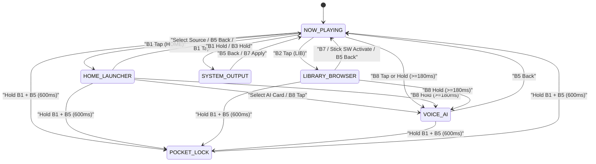

# fbox — On-Device UI/UX & System Architecture (`fbox OS`)

> **Target Hardware Platform:** **`fbox` (`Option P5-Card` — `72.0 × 98.0 × 18.0 mm`, `127.0 cm³`)**  
> **Compute & Display:** `LILYGO T-Display-S3 AMOLED` (`ESP32-S3R8`, `16 MB` Flash + `8 MB` OPI PSRAM, **`1.91"` `536×240` True-Black QSPI `RM67162` AMOLED**)  
> **Audio & Voice:** `GY-PCM5102` Stereo `I2S` DAC (`3.5 mm` `0 V AGND`), `Acxico KCX_BT_EMITTER` (`5 V` Stereo Bluetooth Audio `TX`), `EGSCST INMP441` `24-bit` MEMS Mic behind a recessed `Ø9.6 mm` `21`-dot crosshair grille  
> **Controls & Storage:** `KY-023` Concave Coral Thumb-Disc (`Ø16 mm` in `Ø25 mm` recessed basin) + `2×4` Tactile Keypad (`B1–B4` Matte Black, `B5` Amber, `B6` Teal, `B7` Gold, `B8` Coral) + `WWZMDiB Mini 3.3V MicroSD` (`HSPI`) + `503759 1300 mAh` LiPo  
> **Interactive Simulator:** [`on_device_ui_simulator.html`](./on_device_ui_simulator.html) (`modules/` engine)  
> **Companion Hardware Reference:** [`POCKET_STREAMER_MASTER_REFERENCE.md`](../Pocket%20Streamer%20Hardware%20CAD/POCKET_STREAMER_MASTER_REFERENCE.md)

---

## 1. Design Philosophy & Pocket Ergonomics (`fbox OS`)

`fbox` is a dedicated pocket AI voice assistant and audiobook/music player built to solve the **two failures of smartphone listening**: screen distraction and accidental pocket touches.

1. **Zero-Power True-Black AMOLED (`#000000`):** Every background pixel on the `1.91"` `536×240` `RM67162` AMOLED sits at true `#000000`, drawing zero pixel current while highlighting active controls in the physical `fbox` keycap palette (**Coral `#E0634E`**, **Warm Amber `#E3A84B`**, **Gold `#EBD15E`**, **Teal `#45B09C`**, **BT Cyan `#38BDF8`**).
2. **One-Click Audio Routing (`3.5 mm` ↔ `BT TX`):** Press **`B3`** (`OUT`) on `NOW_PLAYING` to toggle instantly between wired `GY-PCM5102` (`3.5 mm` TRS, `2.1 Vrms`, `112 dB` SNR) and internal `Acxico KCX_BT_EMITTER` Bluetooth `TX` (`AirPods` / wireless earbuds) with zero phone pairing friction.
3. **Analog Thumbstick Expressiveness (`KY-023`):** Tilting the `Ø16 mm` Coral concave disc horizontally in `NOW_PLAYING` scrubs the timeline proportionally (`±1×` to `±16×`); tilting vertically adjusts output gain or scrolls `LIBRARY_BROWSER` lists with `1×`–`6×` proportional velocity.
4. **Hardware-Grade Pocket Lock:** Simultaneous `600 ms` hold of **`B1 + B5`** (top-left black + bottom-left amber) locks all keys and the thumbstick; any stray pocket press flashes an amber warning border and double-beeps softly without changing playback.

---

## 2. Finite State Machine (`FBoxState`)

Both the Safari web simulator (`modules/*.js`) and the `ESP32-S3` firmware (`firmware_p5_card/src/main.cpp`) share the identical `6`-state FSM:

### Active Runtime Modes (Source × Output Path)

| Source (`activeSource`) | Output Target (`btTxOn`) | Physical Signal Path | Firmware Backend |
| :--- | :--- | :--- | :--- |
| **`Audiobookshelf` (`ABS`)** | **`3.5 mm PCM5102`** (`false`) | `ESP32-S3` Wi-Fi HTTP stream → `I2S0` (`GPIO 12/13/14`) → `GY-PCM5102` `3.5 mm` TRS | `ESP32-audioI2S` + ABS progress sync (`REST`) |
| **`Audiobookshelf` (`ABS`)** | **`KCX BT TX`** (`true`) | `ESP32-S3` → `I2S0` → `GY-PCM5102` `L/R/G` → `Acxico KCX_BT_EMITTER` (`A2DP TX`) | Hardware BT `TX` bridge (`5 V` switched) |
| **`Spotify Connect`** | **`3.5 mm` / `BT TX`** | Wi-Fi `Spotify Connect` / Web API control | `cspot` / `Spotify Web API` |
| **`MicroSD Offline`** | **`3.5 mm` / `BT TX`** | `HSPI` (`GPIO 16/39/40/41`) → `MP3/FLAC/WAV` decode → `I2S0` (`Wi-Fi OFF` option) | `SD.h` / `SdFat` + SQLite/NVS bookmarks |

---

## 3. True-Black AMOLED `"fbox OS"` Design Tokens (`536 × 240`)

- **Canvas:** `536 × 240` px (`1.91"` `RM67162` QSPI AMOLED, landscape orientation aligned directly above the controls)
- **Void Background:** `#000000` (`RGB565 0x0000`)
- **Surface Cards:** `#0D1117` (`RGB565 0x0882`) with `1 px` border `#1E293B` (focused `#334155`)
- **Text Hierarchy:** Primary `#F8FAFC`, Secondary `#94A3B8`, Technical Dim `#64748B`
- **Hardware Accent Keycap Tokens:**
  - **fbox Coral (`B8` / Thumb-Disc / AI & Mic):** `#E0634E` (glow `#FB7185`)
  - **fbox Warm Amber (`B5` / Audiobookshelf / Rewind):** `#E3A84B`
  - **fbox Gold (`B7` / Play / Speed / ★ Bookmarks):** `#EBD15E`
  - **fbox Teal (`B6` / Spotify / Local MicroSD / Connected):** `#45B09C`
  - **BT TX Cyan (`KCX_BT_EMITTER` / System):** `#38BDF8`

### Screen Layout Summary (`536 × 240`)
1. **Unified Chrome (`y=0..28` & `y=214..240`):**
   - **Top Status Bar (`28 px`):** `fbox` brand pill, mode badge (`AUDIOBOOKSHELF`, `SPOTIFY`, `MICROSD`, `fbox AI`, `SYSTEM`, `HOME`), output pill (`BT TX · AirPods` vs `3.5mm PCM5102`), Wi-Fi RSSI bars, and `1300 mAh` LiPo `% + V`.
   - **Bottom Key Strip (`26 px`):** Color-coded micro-dots matching the `2×4` physical keycap colors + thumbstick hint.
2. **`HOME_LAUNCHER`:** `4` horizontal high-contrast cards (`Audiobookshelf`, `Spotify Connect`, `MicroSD Offline`, `Gemini AI & Voice Notes`) + live bottom mini-player ticker.
3. **`NOW_PLAYING`:** Left `142×142` procedural artwork (`x=14, y=36`) + right metadata column (`x=172..522`), quick pill bar (`-15s`, `▶ 1.15x`, `+30s`, `★ Mark`, `BT TX / 3.5mm`), chapter tick + bookmark diamond scrubber with `KY-023` live scrub preview bubble, and tabular mono timers + equalizer.
4. **`LIBRARY_BROWSER`:** `5` pill tabs (`ABS Books`, `Chapters`, `Spotify`, `MicroSD`, `★ Marks & Notes`), `4` visible `34 px` rows (`x=12..502`), and right-edge **`KY-023` Analog Velocity HUD** (`x=508..528`) showing live `VRy` tilt & `1×`–`6×` scroll speed.
5. **`VOICE_AI` (`GEMINI AI` ↔ `INMP441 WAV VOICE NOTE`):**
   - **`LISTENING`:** Glowing Coral/Teal orb + `32`-bar symmetric `INMP441` spectrum (`GPIO 15 · 44.1 kHz Shared I2S0`) + streaming transcript or `/NOTES/VN-xxx.WAV` timer.
   - **`THINKING`:** `3`-node Coral/Amber/Teal orbital indicator + live tool-call pipeline badge.
   - **`IDLE / RESPONSE`:** Spoken transcript, tool confirmation badge, `3–4` line wrapped Gemini summary, and `5` quick prompt presets (or MicroSD WAV voice note list + playback preview).
6. **`SYSTEM_OUTPUT` & `POCKET_LOCK`:** Side-by-side `3.5 mm PCM5102` vs `KCX_BT_EMITTER` cards, `503759 LiPo` runtime estimate, `ESP32-S3R8` `PSRAM`/MicroSD telemetry, and dimmed true-black padlock guard.

---

## 4. Physical Control Mapping (`KY-023` + `2×4` Keypad Matrix)

> **GPIO Matrix (`firmware_p5_card`):**  
> - **Rows (`COM`):** `GPIO 42` (Row 1: `B1–B4`), `GPIO 43` (Row 2: `B5–B8`)  
> - **Cols (`K1–K4`):** `GPIO 44, 45, 2, 3` (`INPUT_PULLUP`)  
> - **Thumbstick (`KY-023`):** `VRx = GPIO 1`, `VRy = GPIO 10`, `SW = GPIO 11` (`INPUT_PULLUP`)  
> - **Hold Thresholds:** Standard Hold `>= 380 ms`; `B8` PTT Mic Hold `>= 180 ms`; `B1 + B5` Pocket Lock Combo `>= 600 ms`

| Physical Control | Color | `NOW_PLAYING` | `HOME_LAUNCHER` | `LIBRARY_BROWSER` | `VOICE_AI` | `SYSTEM_OUTPUT` | `POCKET_LOCK` |
| :--- | :--- | :--- | :--- | :--- | :--- | :--- | :--- |
| **`B1`** Tap | Black | Open Home Launcher | Return to Player | Next Library Tab | Flip `Gemini ↔ WAV Note` | Back to Player | *Ignored (Amber Flash)* |
| **`B1`** Hold | Black | Open Output & System | Open Output & System | Open Output & System | Cancel / System | Back to Player | *Ignored* |
| **`B2`** Tap | Black | Open Library Browser | Prev Card | Cursor Up ▲ | Prev Preset / Note | Open Library | *Ignored* |
| **`B2`** Hold | Black | Open Library Browser | — | Jump to Top | — | — | *Ignored* |
| **`B3`** Tap | Black | Toggle `3.5mm ↔ BT TX` | Next Card | Cursor Down ▼ | Next Preset / Note | Toggle `3.5mm ↔ BT TX` | *Ignored* |
| **`B3`** Hold | Black | Open Output & System | Open Output & System | Open Output & System | — | Back to Player | *Ignored* |
| **`B4`** Tap | Black | Save / Toggle `★ Mark` | Save `★ Mark` | Save `★ Mark` | Save `★ Mark` | Save `★ Mark` | *Ignored* |
| **`B4`** Hold | Black | Jump to `★ Marks & Notes` | Jump to `★ Marks` | Jump to `★ Marks` | Jump to `★ Marks` | Jump to `★ Marks` | *Ignored* |
| **`B5`** Tap | Amber | Rewind `-15s` | Back to Player | Back to Player | Back to Player | Back to Player | *Ignored* |
| **`B6`** Tap | Teal | Previous Chapter / Track | Prev Card | Prev Library Tab | Prev Item | — | *Ignored* |
| **`B6`** Hold | Teal | Cycle Speed (`1.0x..2.0x`) | — | — | — | — | *Ignored* |
| **`B7`** Tap | Gold | Play / Pause | Open Selected App | Play Selected Item | Run Preset / Play WAV | Toggle Output | *Ignored* |
| **`B7`** Hold | Gold | Skip Forward `+30s` | Open Selected App | Play Selected Item | — | — | *Ignored* |
| **`B8`** Tap | Coral | Open Voice AI / Notes | Open Voice AI / Notes | Open Voice AI / Notes | Flip `Gemini ↔ WAV Note` | Open Voice AI | *Ignored* |
| **`B8`** Hold (`>=180ms`) | Coral | **🎙 Push-to-Talk / REC** | **🎙 Push-to-Talk / REC** | **🎙 Push-to-Talk / REC** | **🎙 Push-to-Talk / REC** | **🎙 PTT** | *Ignored* |
| **`B1 + B5`** Hold (`600ms`) | Combo | **🔒 Lock fbox** | **🔒 Lock fbox** | **🔒 Lock fbox** | **🔒 Lock fbox** | **🔒 Lock** | **🔓 Unlock fbox** |
| **`KY-023` Stick** (`X / Y`) | Coral Disc | `X`: Scrub `±1x..16x` / `Y`: Vol | `X/Y`: Select Card | `Y`: `1x..6x` Scroll / `X`: Tab | `Y`: Select Preset/Note | `X`: Toggle Output | *Ignored* |
| **`KY-023 SW`** (`GPIO 11`) | Coral Disc | Play / Pause | Open Selected App | Play Selected Item | Run Preset / Play WAV | Toggle Output | *Ignored* |

---

## 5. `ESP32-S3R8` (`8 MB` OPI PSRAM) Display, Audio & Voice Architecture

1. **Full-Frame PSRAM Sprite (`536 × 240 × 16-bit` = `257,280 B`):**
   - Unlike the legacy non-PSRAM `WROOM-32` (`520 KB` total SRAM), `LILYGO T-Display-S3 AMOLED` carries **`8 MB` OPI PSRAM**, allowing a dedicated `257.28 KB` `RGB565` offscreen framebuffer (`ps_malloc(536 * 240 * 2)`) for tear-free `60 fps` compositing, flushed over `QSPI` (`RM67162`) via DMA bursts.
2. **Full-Duplex `I2S0` Bus (`GPIO 12/13/14/15`):**
   - Shared `44.1 kHz` `32-bit` stereo master clock drives both `GY-PCM5102` playback (`DOUT = GPIO 14`) and `INMP441` MEMS microphone capture (`DIN = GPIO 15` with `100 kΩ` pull-down on `SD`).
   - Hardware earcons (`440 Hz → 659 Hz` bookmark chime, `523 Hz → 784 Hz` PTT mic-open chime, `330 Hz → 659 Hz` unlock chime) mix smoothly at `-18 dBFS` directly into the `I2S0` TX ring buffer.
3. **Zero-Conflict MicroSD WAV Notes & Bookmarks (`HSPI` `GPIO 16/39/40/41`):**
   - Holding **`B8`** in `VOICE_NOTE` sub-mode streams `16-bit 44.1 kHz` mono PCM from `INMP441` directly into `/NOTES/VN-xxx.WAV` with a standard 44-byte RIFF header, linked to the active audiobook/track timestamp.
   - Holding **`B8`** in `GEMINI` sub-mode streams captured audio to Gemini (`gemini-2.5-flash` / Live API) with tool declarations for bookmarks, library switching, output routing, and sleep timers.
