# Pocket Audiobook Streamer & Voice Note-Taker — Canonical Master Hardware Reference & `1:1` CAD Specification

> [!IMPORTANT]
> **Authoritative Single Source of Truth (Supersedes Legacy Pi Zero CAD Docs)**  
> This document is the canonical engineering reference for all subsequent mechanical CAD, shell printing, wiring, image generation, and firmware tasks. It supersedes [`HARDWARE_CAD_SPEC_AND_BOM.md`](file:///Users/benfox/Development/3D%20Design/Pocket%20Streamer%20Hardware%20CAD/HARDWARE_CAD_SPEC_AND_BOM.md) (legacy Pi Zero 2 WH concept) and locks the architecture to the **Zero-Solder Amazon ESP32 + 1.9" IPS + WM8960 + `18650` V3** build verified against [media_1794718210280_73698bc3.jpg](file:///Users/benfox/.gemini/antigravity/brain/d773b1b3-4405-4408-8ad7-b59f103e4218/.user_uploaded/media_1794718210280_73698bc3.jpg).

---

## 1. Verification Provenance & Governance

All dimensions, header geometries, GPIO rules, cable volumes, and electrical budgets in this document have been audited by five Wave-1 subsystem agents, reconciled by a **Principal Hardware Systems Verifier** (`6fe2f93a`), and signed off quantitatively by a **Senior Embedded Electrical Engineer** (`e7f8f520`):

| Audit Layer | Agent / Role | Verified Scope |
|---|---|---|
| **Wave-1 Group 01** | `ESP32 1.9-in IPS Auditor` (`bcf09230`) | `ideaspark` `B0D6QXC813` dimensions, downward `2×19` headers, `ST7789` pinout (`TFT_CS` `15` vs `5`), `520 KB` non-PSRAM heap limits, `SS14`/`AMS1117-3.3` path |
| **Wave-1 Group 02** | `WM8960 Audio & Hub Auditor` (`d0da25e5`) | Waveshare `15668` Pi Zero HAT dimensions (`65×30 mm`), `3070` enclosed speakers (`70×30×17 mm`), `24 MHz` XTAL Master/Slave rule, `94 dB` ADC vs `58 dB` MEMS SNR, capless `OUT3` (`1.65 V`) safety |
| **Wave-1 Group 03** | `Controls & MicroSD Auditor` (`3bc622e0`) | `KY-023` `3.3V` + `ADC1` rule, `1×4` Keypad upward `1×5` header clash (`+31 mm` mated), `WWZMDiB` `AMS1117-3.3` `5V`-only rule + `74LVC125A` permanent `MISO` drive bug |
| **Wave-1 Group 04** | `Cable Bulk & Z-Stack Auditor` (`68ddffd2`) | `14.0 mm` DuPont housing + `6.0 mm` bend proof (`28 AWG` CCA), non-overlapping `(X, Y)` Z-stack proof, `200 mm` slack-loop volume (`22–28 cm³`), anti-vibration comb clamps |
| **Wave-1 Group 05** | `18650 Battery System Auditor` (`e6d7dc16`) | `ACEIRMC V3` unpopulated side pads, Topology A `USB-A → C` interlock vs pre-Schottky split, flat-top `65×Ø18.3 mm` cell mandate, `TP4056` `75–85 °C` heat (`PETG/ASA`), `Hold` drain, NVS coulomb model |
| **Wave-2 Gatekeeper** | `Principal Hardware Systems Verifier` (`6fe2f93a`) | Cross-agent conflict resolution (`38-pin` visual header check, `3070` speaker envelope, `GPIO 16` `SD_CS`, collision-free `156×112×49 mm` coordinates) |
| **Electrical Sign-Off** | `Senior Embedded Electrical Engineer` (`e7f8f520`) | Node-by-node Ohm's Law drop cascade, `SS14`/`MBR0520` `D1` current limit (`<=65–70%` speaker gain + mute guard), 3-LDO isolation, NXP `UM10204` I2C RC timing (`100 kHz`), `GPIO 12 MTDI` post-boot `INPUT_PULLUP` & `30/38-pin` portability |

---

## 2. Locked-In Zero-Solder Amazon BOM & Cost Matrix

| ID | Component | ASIN / SKU | Qty / Pack | List Price | Notes & Procurement Guardrails |
|---|---|---|---|---|---|
| **01** | `ideaspark ESP32 16MB + 1.9" ST7789 IPS (170×320, USB-C, CH340, pre-soldered headers)` | `B0D6QXC813` | `1` | `\$15.99` | Photo shows `2×19` (`38-pin`) downward male headers; pin map also supports rare `30-pin` runs (`no GPIO 0`). Probe `TFT_CS` (`15` vs `5`) & `D1` Schottky on Day 1. |
| **02 + 02b** | `WM8960 Hi-Fi Sound Card HAT + Dual 3070 8Ω 1W Stereo Speakers + Dual MEMS Mics` | `B0GH6JCGNV` *(Waveshare `15668` clone)* | `1` HAT + `2` spk | `\$24.29` | Bundle includes `65×30 mm` Pi Zero HAT + `2× 70×30×17 mm` `3070` speaker boxes pre-terminated to a single `4-pin JST PH 2.0` plug. |
| **03** | `6-Pack KY-023 Dual-Axis XY PS2 Thumbstick Module` | `B0D83FD3M8` | `1` used (`6`-pk) | `\$9.99` *(`\$9.49` w/ `-\$0.50` coupon)* | Wire `"+5V"` pin **strictly to `ESP32 3V3`** (`0.66 mA`) so `VRx/VRy` stay `0–3.30 V` (`ADC1`-safe). |
| **04** | `GODIYMODULES 5-Pack 1×4 Tactile Button Keypad` | `B0GW8BP2KR` | `1` used (`5`-pk) | `\$6.99` | Ships with straight-up `1×5` pins on the switch side (`28.5–31.0 mm` mated); **0** SMD pull-ups, **no** `VCC` pin. |
| **05** | `WWZMDiB 3-Pack MicroSD TF Card SPI Reader Module` | `B0B779R5TZ` | `1` used (`3`-pk) | `\$5.99` | Onboard `AMS1117-3.3` **requires `5V` (`>=4.45 V`) on `VCC`**; `74LVC125A` `MISO` never tri-states (isolate on `HSPI`). |
| **06** | `ELEGOO 120pcs 20cm (8-inch) DuPont Jumper Wires (M-F, M-M, F-F)` | `B01EV70C78` | `25` used (`12 F-F + 13 M-F`) | `\$6.98` | `28 AWG` CCA (`Ø1.30 mm`, `~0.10–0.15 Ω` loop per wire); `14.0 mm` rigid shell + `6.0 mm` minimum bend zone. |
| **07** | `ACEIRMC 2-Pack 18650 Single Battery Shield V3` | `B0DFYDCGHP` | `1` used (`2`-pk) | `\$9.99` | Side `3V/5V` pads ship unpopulated; power exits **only** via `USB-A` unless soldered. No load-sharing; no reverse-polarity protection. |
| **08** | `2-PCS 18650 Flat-Top 3.7V Rechargeable Cells` | `B0HQPL867D` *(or `Samsung 25R` `B0BSLT62K6`)* | `1` cell used (`2`-pk) | `\$15.99` *(`\$28.89` `25R`)* | **Flat-top unprotected `65.0×Ø18.3 mm` ONLY.** Avoid unverified/rewrapped marketplace cells; preferred genuine source is an authorized distributor (`Samsung 35E` `3500 mAh` or `Molicel P28A` at `~ \$4–\$7/cell`). |
| *Opt.* | `MEIRIYFA USB-A to 4-Pin DuPont Cable (30 cm)` + `Wago 221-415` | `B0BV9K69M9` | `1` *(Topology A-Star only)* | `\$9.90` *(+ Wago)* | Needed **only** if upgrading from default Topology A to **Topology A-Star** for un-capped `100%` dual-speaker blasts during Wi-Fi/SD writes. |

**BOM Cost Summary:**
- **Core 6 Ordered Amazon Audio/Control Items (`01..06`):** **`\$70.23`** list (**`\$69.73`** with `-\$0.50` coupon).
- **Full 8-Item Portable System (`01..08` incl. V3 Shield + `18650` pair):** **`\$96.21`** list (**`\$95.71`** with coupon).

---

## 3. Piece-by-Piece Verified Mechanical, Port & Header Dossier (`mm`)

| Part ID & Name | Bare PCB (`L×W×T`) | Mounting Holes (C-to-C) | Critical Features, Overhangs & Variance Catches | Mated Envelope (`X×Y×Z` w/ `14+6 mm` DuPont) |
|---|---|---|---|---|
| **`01` `ideaspark` ESP32 1.9" IPS** (`B0D6QXC813`) | `63.7 × 31.5 × 1.6` *(tol. `63.8`)* | `4× Ø2.0–2.2` corner holes *(measure pitch on arrival; Amazon `72×52 mm` is box size, NOT PCB)* | `1.9"` `170×320` IPS glass `49.72 × 25.80 × 1.48` (`42.72 × 22.70` active AA); FPC exits left short end (`>=2.0 mm` bezel bend relief); `USB-C` overhangs `+1.5 mm` (`±0.4 mm` batch shift); `2×19` (`38-pin`) downward pins (`48.26 mm` plastic, `27.94 mm` row pitch, `-11.0 mm` below PCB); `WROOM-32` (`18×25.5×3.1`) underside antenna opposite `USB-C` | **`65.2 × 31.5 × 28.6`** *(`24.1 mm` PCB-top-to-DuPont-bend + `4.5 mm` LCD stack; `22.5 mm` Z below PCB bottom)* |
| **`02` `WM8960` Audio HAT** (`B0GH6JCGNV` / Waveshare `15668`) | `65.0 × 30.0 × 1.6` *(Pi Zero pHAT — NOT `65×56 mm`)* | `4× Ø2.75` (`M2.5`) @ `58.0 × 23.0` | Bottom `2×20` non-pass-through socket (`50.8 × 5.0 × 8.5 mm` below PCB); top `3.5 mm` TRS jack (`14.0 × 8.5 × 5.0`, `+2.0 mm` edge overhang); top vertical `4-pin JST PH 2.0` (`9.9 × 4.5 × 6.0`, **`+14.0 mm`** mated+bend Z above PCB); top tactile `K1` (`6×6×5.0`, `Pin 11`); dual `AOS3729A-T42` MEMS mics (`3.76 × 2.95 × 1.10`) | **`65.0 × 32.0 × 44.1`** *(`28.5 mm` below PCB + `1.6` PCB + `14.0` JST zone; `36.1 mm` at TRS jack zone)* |
| **`02b` Dual `3070` Enclosed Speakers** (`8Ω 1W`) | `70.0 × 30.0 × 17.0` each *(tol. `16.0–18.5` H)* | Integral corner mounting tabs *(`~63×24 mm`; caliper Monday)* | Two separate sealed ABS cavity boxes (each **larger than the `65×30 mm` HAT PCB**; reject earlier `100×45×21 mm` estimate); pre-wired `150–420 mm` twisted pairs Y-merged into `4-pin JST PH 2.0`; requires `1.0 mm` closed-cell TPU/EVA front baffle gasket | **`70.0 × 30.0 × 18.0`** each *(with `1.0 mm` gasket; `71.4 cm³` bare pair)* |
| **`03` `KY-023` Dual-Axis Thumbstick** (`B0D83FD3M8`) | `34.0 × 26.0 × 1.6` *(`+2.0 mm` underside tails)* | `4× Ø3.0–3.2` (`M3`) @ `27.0 × 20.0` *(use socket caps — tight to header/pots)* | `16.0 × 16.0 × 12.2 mm` gimbal (`~20×20` w/ pots); `Ø26.0 mm` curved dome skirt; `Ø17.0 mm` removable mushroom cap; `±25°` tilt needs **`Ø23.0–24.0 mm`** faceplate hole; **`90°` `1×5` header** adds `+22.0–22.5 mm` lateral X | **`56.0 × 26.0 × 34.0`** *(`32.0 mm` PCB-bottom to cap + `2.0 mm` tails)* |
| **`04` `GODIYMODULES 1×4` Keypad** (`B0GW8BP2KR`) | `37.0 × 15.0 × 1.6` *(`+1.5 mm` underside tails)* | `4× Ø2.2` (`M2`) @ `~32.0 × 10.0` | **UPWARD HEADER TRAP:** Four `6×6 mm` tact switches reach `11.0 mm` Z from PCB bottom, **but the `1×5` yellow male header points STRAIGHT UP on the switch side (`13.1 mm` bare -> `28.5–31.0 mm` mated!)**, towering `~17–20 mm` past the button caps. **Zero** SMD pull-ups, **no** `VCC` pin | **Option 1 (Recessed):** `37.0 × 15.0 × 31.0` *(PCB at `Z=15.0`, `4×` captive `20.5 mm` plungers)* **Option 2 (`90°` pin bend):** `37.0 × 36.0 × 12.5` |
| **`05` `WWZMDiB` MicroSD SPI Reader** (`B0B779R5TZ`) | `42.0 × 24.0 × 1.6` *(`6.5 mm` Z w/ cage & tails)* | `4× Ø2.2` (`M2`) @ `38.0 × 20.0` | Push-push stainless TF slot (`~2.0 mm` push stroke, **`~4.5 mm` eject pop-out** -> needs chamfered fingernail scoop); opposite **`90°` `1×6` header** adds `+22.0–22.5 mm` lateral X | **`64.0 × 24.0 × 6.5`** *(`66.5–69.0 mm` during `4.5 mm` card eject)* |
| **`06` `ELEGOO` `20 cm` DuPont Harness** (`B01EV70C78`) | `1P`: `14.0 × 2.54 × 2.54` *(`2.75` max w/ flash)* | `14.0 mm` printed comb clamps + Kapton/heat-shrink | `200 mm` `28 AWG` CCA (`~175 mm` flex PVC between shells, `Ø1.30 mm`); `6.0 mm` min bend clearance (`20.0 mm` total beyond seated header shoulder) | **`25` wires (`3.24–3.92 m` slack) = `22.0–28.0 cm³`** displaced bundle volume |
| **`07` `ACEIRMC` `18650` Shield V3** (`B0DFYDCGHP`) | `99.5 × 29.2 × 21.0` *(batch tol. `98–100.5`)* | Perimeter snap-in cradle rails *(corner holes omitted/varied on clones!)* | **`3V/5V` side pads ship UNPOPULATED**; `USB-A` out (`14.0 × 10.5 × 7.0`); `11.5 × 6.5 mm` charge slot (`Micro-USB` OR `USB-C` clone roulette); `Normal/Hold` slide switch (`6×4×3.5`); `K1` tactile button; `4×` capacity + Charge/Full LEDs | **`100.5 × 30.2 × 22.0`** cradle bay *(+ left-wall `USB-A → C` U-bridge `~10 mm`)* |
| **`08` `18650` Li-Ion Cell** | `65.0 × Ø18.3` | Cradle spring clips | **Flat-top unprotected ONLY (`<=65.0 mm`).** Button-top protected cells (`69–70.5 mm`) crush negative spring and risk wrapper-tear dead shorts | Fits inside `V3` holder |

---

## 4. `1:1` Scale 3D CAD Suite, Exact XYZ Coordinates & `image-generator` Protocol

All 9 BOM components and the verified packaging assembly were generated at exact **`1:1` scale** (`1 mm = 0.001 m` in `.usdz` and native millimeters in OpenSCAD / Metal orthographic PNGs) and passed an automated pairwise `AABB` collision check with **`0` collisions across all 14 collision-checked module, DuPont keepout, and service-loop volumes**:

### Canonical `1:1` File Index (`.usdz`, `.png`, `.scad`, `.swift`)

| Piece / Artifact | `1:1` `.usdz` 3D Model | Calibrated `1:1` Metal Reference `.png` *(10 mm Grid)* |
|---|---|---|
| **Master Lineup + Scale Card** | — | [00_master_1to1_parts_lineup_ref.png](file:///Users/benfox/Development/3D%20Design/Pocket%20Streamer%20Hardware%20CAD/parts_1to1_3d/renders/00_master_1to1_parts_lineup_ref.png) |
| **`01` `ideaspark` ESP32 1.9" IPS** | [01_ideaspark_esp32_19_ips.usdz](file:///Users/benfox/Development/3D%20Design/Pocket%20Streamer%20Hardware%20CAD/parts_1to1_3d/01_ideaspark_esp32_19_ips.usdz) | [ref_01_esp32_19_ips.png](file:///Users/benfox/Development/3D%20Design/Pocket%20Streamer%20Hardware%20CAD/parts_1to1_3d/renders/ref_01_esp32_19_ips.png) |
| **`02` `WM8960` Audio HAT** | [02_wm8960_audio_hat.usdz](file:///Users/benfox/Development/3D%20Design/Pocket%20Streamer%20Hardware%20CAD/parts_1to1_3d/02_wm8960_audio_hat.usdz) | [ref_02_wm8960_audio_hat.png](file:///Users/benfox/Development/3D%20Design/Pocket%20Streamer%20Hardware%20CAD/parts_1to1_3d/renders/ref_02_wm8960_audio_hat.png) |
| **`02b` `3070` Speaker Box** | [02b_wm8960_speaker_box.usdz](file:///Users/benfox/Development/3D%20Design/Pocket%20Streamer%20Hardware%20CAD/parts_1to1_3d/02b_wm8960_speaker_box.usdz) | [ref_02b_speaker_box.png](file:///Users/benfox/Development/3D%20Design/Pocket%20Streamer%20Hardware%20CAD/parts_1to1_3d/renders/ref_02b_speaker_box.png) |
| **`03` `KY-023` Thumbstick** | [03_ky023_thumbstick.usdz](file:///Users/benfox/Development/3D%20Design/Pocket%20Streamer%20Hardware%20CAD/parts_1to1_3d/03_ky023_thumbstick.usdz) | [ref_03_ky023_thumbstick.png](file:///Users/benfox/Development/3D%20Design/Pocket%20Streamer%20Hardware%20CAD/parts_1to1_3d/renders/ref_03_ky023_thumbstick.png) |
| **`04` `1×4` Tactile Keypad** | [04_godiymodules_1x4_keypad.usdz](file:///Users/benfox/Development/3D%20Design/Pocket%20Streamer%20Hardware%20CAD/parts_1to1_3d/04_godiymodules_1x4_keypad.usdz) | [ref_04_godiymodules_1x4_keypad.png](file:///Users/benfox/Development/3D%20Design/Pocket%20Streamer%20Hardware%20CAD/parts_1to1_3d/renders/ref_04_godiymodules_1x4_keypad.png) |
| **`05` `WWZMDiB` MicroSD** | [05_wwzmdib_microsd_reader.usdz](file:///Users/benfox/Development/3D%20Design/Pocket%20Streamer%20Hardware%20CAD/parts_1to1_3d/05_wwzmdib_microsd_reader.usdz) | [ref_05_wwzmdib_microsd.png](file:///Users/benfox/Development/3D%20Design/Pocket%20Streamer%20Hardware%20CAD/parts_1to1_3d/renders/ref_05_wwzmdib_microsd.png) |
| **`06` DuPont `20 cm` Bundle** | [06_dupont_housing_and_20cm_bundle.usdz](file:///Users/benfox/Development/3D%20Design/Pocket%20Streamer%20Hardware%20CAD/parts_1to1_3d/06_dupont_housing_and_20cm_bundle.usdz) | [ref_06_dupont_housing_and_20cm_bundle.png](file:///Users/benfox/Development/3D%20Design/Pocket%20Streamer%20Hardware%20CAD/parts_1to1_3d/renders/ref_06_dupont_housing_and_20cm_bundle.png) |
| **`07` `ACEIRMC` `18650` V3 + Cell** | [07_aceirmc_18650_shield_v3.usdz](file:///Users/benfox/Development/3D%20Design/Pocket%20Streamer%20Hardware%20CAD/parts_1to1_3d/07_aceirmc_18650_shield_v3.usdz) | [ref_07_18650_shield_v3.png](file:///Users/benfox/Development/3D%20Design/Pocket%20Streamer%20Hardware%20CAD/parts_1to1_3d/renders/ref_07_18650_shield_v3.png) |
| **`08` Verified Packaging Assembly** | [08_verified_collision_free_assembly.usdz](file:///Users/benfox/Development/3D%20Design/Pocket%20Streamer%20Hardware%20CAD/parts_1to1_3d/08_verified_collision_free_assembly.usdz) | [ref_08_verified_assembly_views.png](file:///Users/benfox/Development/3D%20Design/Pocket%20Streamer%20Hardware%20CAD/parts_1to1_3d/renders/ref_08_verified_assembly_views.png) |
| **Parametric CAD Sources** | [pocket_streamer_verified_1to1_parts.scad](file:///Users/benfox/Development/3D%20Design/Pocket%20Streamer%20Hardware%20CAD/pocket_streamer_verified_1to1_parts.scad) | [generate_1to1_verified_parts.swift](file:///Users/benfox/Development/3D%20Design/Pocket%20Streamer%20Hardware%20CAD/generate_1to1_verified_parts.swift) |

### Exact Verified Assembly Coordinate Table (`156.0 × 112.0 × 49.0 mm` Outer PETG/ASA Shell)

Coordinate origin `(0, 0, 0)` is the **Back-Bottom-Left outer shell corner**: **`+X` Right (`0..156.0`)**, **`+Y` Top (`0..112.0`)**, **`+Z` Front (`0..49.0`)**. Wall thickness `2.4 mm` on all faces (interior cavity: `X ∈ [2.4, 153.6]`, `Y ∈ [2.4, 109.6]`, `Z ∈ [2.4, 46.6]`). Coordinates below match [`generate_1to1_verified_parts.swift`](file:///Users/benfox/Development/3D%20Design/Pocket%20Streamer%20Hardware%20CAD/generate_1to1_verified_parts.swift#L475-L565) directly:

| Assembly Element (`buildPart08AssemblyAndVerify`) | `X` Span (`mm`) | `Y` Span (`mm`) | `Z` Span (`mm`) | Clearances & Mechanical Interfaces |
|---|---|---|---|---|
| **1. `ACEIRMC V3 + 18650` (`v3_bay`)** | `2.4 .. 101.9` | `2.9 .. 32.1` | `2.9 .. 23.9` | PCB bottom `Z=4.3` (`2.9` underside IC clearance); `USB-A` at left wall `X=2.4`; bottom-wall slots for charge port, `Normal/Hold` switch, `K1`, `TP4056` vents; back-wall LED light-pipe |
| **2. `3070` Speaker Left + Gasket (`spk_L`)** | `3.2 .. 73.2` | `3.0 .. 33.0` | `28.6 .. 46.6` | **`+4.7 mm` Z clearance above `V3` (`Z=23.9..28.6`)**; `1.0 mm` TPU gasket `Z:45.6..46.6`; front grille at `Z=46.6..49.0` |
| **3. `3070` Speaker Right + Gasket (`spk_R`)** | `78.8 .. 148.8` | `3.0 .. 33.0` | `28.6 .. 46.6` | **`+5.6 mm` X clearance from Speaker Left** (`X:73.2..78.8`); sits cleanly over `T3` wire trunk (`Z <= 18.0`) |
| **4. `ideaspark` ESP32 + 1.9" LCD (`esp_top`)** | `2.4 .. 67.6` | `75.5 .. 107.0` | `38.9 .. 45.3` | PCB bottom `Z=42.1`; `USB-C` flush in left wall `X=2.4`; `WROOM-32` antenna at right end (`>=8.4 mm` X clear from HAT) |
| **4b. `ideaspark` `2×19` Pins + `F-F` Keepout (`esp_hdrs`)** | `9.5 .. 58.0` | `76.0 .. 106.5` | `19.6 .. 42.1` | Models true `14.0 mm` DuPont shell + `6.0 mm` bend below PCB; leaves `Z=2.4..19.6` open underneath (`T1`) |
| **5. `WM8960` HAT PCB + TRS + Mics + JST (`wm_pcb`)** | `76.0 .. 141.0` | `77.6 .. 109.6` | `30.9 .. 46.5` | `3.5 mm` TRS jack exits top wall `Y=109.6`; dual MEMS mics (`Z≈33.6`) sit beneath stepped front mic terrace + sealed TPU boots; top JST plug localized |
| **5b. `WM8960` `40-Pin` + `M-F` Keepout (`wm_40p`)** | `83.1 .. 133.9` | `78.4 .. 83.8` | `2.4 .. 30.9` | `28.5 mm` mated column below PCB reaches cleanly to rear inner wall `Z=2.4` with zero interference |
| **6. `KY-023` Thumbstick (`ky_body` + `ky_cable`)** | `6.0 .. 40.0` *(+ cable `40.0 .. 62.0`)* | `41.0 .. 67.0` *(`47.0 .. 61.0`)* | `21.5 .. 55.5` *(`24.8 .. 30.9`)* | `Ø24 mm` faceplate bore; mushroom thumb cap protrudes `6.5 mm` proud (`Z=49.0..55.5`); `+10.0 mm` X clear of keypad (`62.0..72.0`) |
| **7. `1×4` Tactile Keypad (`pad_body`, Option 1)** | `72.0 .. 109.0` | `47.0 .. 62.0` | `15.0 .. 50.5` | Recessed PCB at `Z=15.0` hides the entire upward `1×5` `14+6 mm` DuPont keepout cleanly inside front wall (`Z<=46.0`); `4×` captive `20.5 mm` plungers extend to `Z=50.5` |
| **8. `WWZMDiB` MicroSD + `90° 6P` (`sd_all`)** | `89.6 .. 156.1` | `42.0 .. 66.0` | `3.0 .. 9.5` | Push-push slot at right wall `X=153.6` (`+2.5 mm` card protrusion/scoop); `90°` `6P` cable exits `-X` (`89.6..111.6`) |
| **8b. SD/Keypad Isolation Shelf (`shelf`)** | `72.0 .. 153.0` | `42.0 .. 66.0` | `11.2 .. 12.6` | Rigid `1.4 mm` internal barrier separating MicroSD (`Z<=9.5`) from recessed Keypad (`Z>=15.0`) |
| **9. `200 mm` Service-Loop Trunk (`trunk_t3`)** | `109.0 .. 147.0` | `6.0 .. 28.0` | `4.0 .. 18.0` | Seated in Trough `T3` (`104.5..153`, `3..34`, `2.4..26.5`) beneath Right Speaker (`+10.6 mm` Z clearance) |
| **10. Topology A `USB-A → C` U-Bridge (`u_bridge`)** | `-7.6 .. 2.4` | `10.5 .. 96.5` | `4.5 .. 43.0` | Removable low-profile left-wall interlock connecting `V3 USB-A` (`Y≈17`) and `ESP32 USB-C` (`Y≈91`) |

> [!TIP]
> **Mandatory `image-generator` 1:1 Reference Protocol**  
> Whenever prompting `image-generator` for photorealistic industrial-design concepts, exploded views, or in-hand renders, always attach [`00_master_1to1_parts_lineup_ref.png`](file:///Users/benfox/.gemini/antigravity/brain/d773b1b3-4405-4408-8ad7-b59f103e4218/00_master_1to1_parts_lineup_ref.png), [`ref_08_verified_assembly_views.png`](file:///Users/benfox/.gemini/antigravity/brain/d773b1b3-4405-4408-8ad7-b59f103e4218/ref_08_verified_assembly_views.png), and the individual `ref_01..ref_07` sheets from the artifact directory so the `1.9"` screen (`42.72×22.70 mm`), `156×112×49 mm` silhouette, `KY-023` thumbstick, and `85.6×54.0 mm` ISO credit-card proportion stay true-to-scale.

---

## 5. Cable Bulk (`25` DuPont + `JST`), `14.0 + 6.0 mm` Z-Stack & `200 mm` Service-Loop Engineering

1. **Mathematical Proof Against `(X, Y)` Component Stacking:**
   - Mated `ideaspark` ESP32 Z-depth = `4.5 mm (LCD/PCB) + 2.5 mm (header base) + 14.0 mm (F shell) + 6.0 mm (bend) =` **`27.0–28.6 mm`**.
   - Mated `WM8960` HAT Z-depth = `6.0 mm (3.5 mm jack) + 1.6 mm (PCB) + 8.5 mm (socket) + 14.0 mm (M shell) + 6.0 mm (bend) =` **`36.1 mm`** (or **`44.1 mm`** at the `4-pin JST PH 2.0` corner).
   - Stacking `ESP32` over `WM8960` on shared `(X, Y)` forces `28.6 + 36.1 + 2.0 =` **`66.7 mm` internal thickness** (`~71.5 mm` outer), making flat side-by-side zoned placement mandatory.
2. **Exact System Conductor Count (`25` DuPont + `1` JST Harness):**
   - **`12 ×` Female-to-Female (`F-F`)** + **`13 ×` Male-to-Female (`M-F`)** = **`25` DuPont conductors** (`~55 mm` weighted average point-to-point run; **`0` wires double-booked on any header pin**).
   - Plus **`1 ×` pre-wired `4-pin JST PH 2.0` harness** connecting both `3070` speakers to `WM8960` (`J1` / `SPK_CON`).
3. **Excess Slack Volume (`cm³`) vs. Dedicated Troughs:**
   - Each `200 mm` wire (`~175 mm` flex PVC between rigid `14.0 mm` shells) leaves `120–135 mm` excess length -> **`~3.24–3.92 m`** cumulative wire slack inside the case.
   - A `2×`-folded S-loop packs at **`Ø10–12 mm`** (`~115 mm²` cross-section), occupying **`22.0–28.0 cm³`** realistic cavity volume incl. `R6.0 mm` U-turns.
   - Our assembly provides **`104.63 cm³`** of unobstructed trough volume across **`T1`** (`22.07 cm³`, under ESP32), **`T2`** (`46.34 cm³`, left mid-cavity), and **`T3`** (`36.22 cm³`, right bottom below Speaker R) — **`>3.7×` headroom** with zero lid crush.
4. **Zero-Solder Drop Retention Rules:**
   - Keep multi-wire banks ganged (`4P`, `5P`, `6P`) or bind loose `1P` shells tightly with **2 wraps of `12 mm` Kapton tape + `2:1` heat-shrink** so individual `2.75 mm`-wide shells cannot splay off `2.54 mm` headers.
   - Print **`14.0 mm` PETG/ASA backstop comb shelves** behind every header shoulder so shock loads transfer into the chassis instead of levering `0.635 mm` pins.

---

## 6. `18650` Battery & Power-Tree Architecture

```mermaid
flowchart LR
    BAT["Flat-Top 18650 Cell (65.0 x 18.3 mm, Unprotected)"] --> PROT["DW01A + 8205A Protection (Zero Reverse-Polarity Guard)"]
    PROT --> BOOST["V3 5.05V Boost Converter (Normal/Hold Switch)"]
    CHG["USB-A to USB-C 5V Brick (Missing 5.1k CC Resistors)"] --> TP["TP4056 Linear Charger (75-85 C -> PETG/ASA + Vents)"]
    TP --> BAT
    BOOST -->|"USB-A Port (Side 3V/5V Pads Unpopulated)"| BRG["Topology A: Left-Wall USB-A to USB-C U-Bridge"]
    BRG -->|"Physically Occupies USB-C (Zero PC Backfeed)"| USBC["ideaspark USB-C -> D1 Schottky (Check >= 1A SS14!)"]
    USBC -->|"ESP32 VIN (~4.62-4.68V @ <= 70% Spk)"| ESP_LDO["ESP32 AMS1117-3.3 -> WROOM-32 + 1.9in ST7789 + KY-023 (0.66mA)"]
    USBC -->|"Wire 1 (VIN -> Pin 2)"| WM_5V["WM8960 Pins 2 & 4 (SPKVDD + RT9193-33; Pins 1 & 17 Strictly NC)"]
    WM_5V -->|"Wire 2 (Pin 4 -> SD VCC >= 4.46V)"| SD_LDO["MicroSD AMS1117-3.3 -> TF Slot + 74LVC125A"]
    BOOST -.->|"Optional Topology A-Star: B0BV9K69M9 + Wago 221-415 (100% Spk)"| WM_5V
```

### Battery System Engineering & Safety Rules
1. **Unpopulated `V3` Side Pads & Power-Exit Choice:**
   - Every `3V` and `5V` side row on `ACEIRMC V3` ships unpopulated. **Topology A (`100%` zero-solder default)** exits cleanly through `V3 USB-A` via a removable left-wall `USB-A → USB-C` U-bridge into `ideaspark USB-C`. This **physically interlocks** laptop flashing (you must remove the battery bridge to plug a USB-C data cable, guaranteeing zero PC backfeed).
   - **Topology A-Star (Optional High-Volume Upgrade):** Splitting pre-Schottky `USB-A` with `B0BV9K69M9` + `Wago 221-415` feeds `WM8960` and `MicroSD` directly at `4.75–5.00 V` (bypassing `D1`) if un-capped `100%` dual-speaker blasts during simultaneous Wi-Fi/SD writes are ever desired. *(Still feed `ESP32` via `USB-C` so `D1` continues blocking PC-USB backfeed.)*
2. **Mandatory Flat-Top Cell & Reverse-Polarity Prevention:**
   - Use **flat-top unprotected `18650` cells (`65.0 × Ø18.3 mm`) ONLY**. Protected `69–70.5 mm` button-tops permanently crush the V3 negative coil spring and risk tearing the wrapper into a dead short.
   - **Zero Reverse-Polarity Protection:** `DW01A + 8205A` only protects against `OVP (~4.28 V)`, `UVP (~2.45 V)`, and short-circuit (`~3 A`); reversing the cell shorts directly through `8205A` body diodes and destroys `TP4056/DW01A` in `<1 s`. Mold `>= 1.5 mm` embossed **`+` / `-`** shell reliefs + positive-end pocket key and meter-check orientation before insertion.
3. **Thermal Material Choice (`PETG/ASA` ONLY) & No Load-Sharing:**
   - `TP4056` linear dissipation reaches `1.04–1.60 W` (`~75–85 °C` internal PCB/air), exceeding **PLA** glass-transition (`55–60 °C`). Print strictly in **`PETG` (`T_g ≈ 80–85 °C`)** or **`ASA` (`T_g ≈ 100 °C`)** with convective slots above `V3`.
   - `V3` has **no** load-sharing P-FET: always **slide Master Switch OFF / unplug U-bridge when charging**, and charge with a **`USB-A to USB-C` cable** (`USB-C` V3 clones frequently omit `5.1 kΩ` `CC1/CC2` resistors).
4. **Idle Drain & Zero-Solder Fuel Gauge:**
   - `Hold` keeps the boost rail active (`~18–22 mA` quiescent battery draw -> **`~4.5–7 days`** unplugged shelf drain; **`~2.1 days`** with sleeping ESP32 attached). Expose `Normal/Hold` externally as the **Master Power Switch** (`Normal` cuts off after `10–30 s` when load `<30 mA`; verify paused playback stays `>35 mA` or treat `Normal` as sleep-off).
   - Expose V3's `4×` capacity LEDs via a **`Ø2.5–3.0 mm` clear acrylic light-pipe** + captive `K1` button plunger, paired with an **NVS-persisted time×state coulomb estimator** in firmware.

---

## 7. Senior Embedded Electrical Engineering Sign-Off & Quantitative Guardrails

> [!WARNING]
> **Senior Embedded Electrical Engineer Verdict (`e7f8f520`): PASS WITH MANDATORY GUARDRAILS**  
> Default Topology A **FAILS** if run with un-capped `100%` dual-`8Ω` speakers alongside Wi-Fi + SD writes (`MicroSD VCC` sags to `3.80–4.22 V < 4.45 V` dropout and overstresses `D1`), and **FAILS** if printed in **PLA** (`75–85 °C` `TP4056` soak). Enforcing the six hardware/firmware guardrails below brings **all subsystems to PASS**.

| # | Audited Electrical Check | Quantitative Proof & Threshold | Verdict | Mandatory Guardrail / Fix |
|---|---|---|---|---|
| **1a** | **Topology A Voltage Cascade: Headphone + Wi-Fi** (`~200 mA` avg / `400 mA` TX burst) | `V3=5.00/4.90 V` → U-bridge (`0.05 Ω`) → `D1 Vf=0.35/0.41 V` → `ESP32 VIN=4.64/4.47 V` → `28 AWG CCA` (`0.15 Ω/hop`, `45 mA` downstream) → **`MicroSD VCC = 4.63/4.46 V`** (`>= 4.45 V` `AMS1117-3.3` dropout floor) | **PASS W/ GUARDRAIL** | Inspect `D1` >= `1 A` (`SS14` SMA preferred over `0.5 A MBR0520` clone); optional `100–470 µF` low-ESR bulk cap on `VIN-GND` |
| **1b** | **Topology A Voltage Cascade: Offline Voice Note WAV Write** (`~150–220 mA` avg, `265 mA` peak) | `Wi-Fi OFF`, `Spk OFF` → `ESP32 VIN=4.62–4.64 V` → 2-hop CCA drop (`0.034–0.049 V`) → **`MicroSD VCC = 4.57–4.60 V`** (`+0.12 to +0.14 V` margin) | **PASS W/ GUARDRAIL** | Force `Wi-Fi OFF` and **`R49 SPK_OP_EN = 00`** during active SD WAV recording |
| **1c** | **Un-capped `100%` Dual `8Ω` Speakers + Wi-Fi + SD** (`~750–1,045 mA` peak) | `2×1W BTL @ 87%` = `530 mA` + Wi-Fi `380 mA` + SD `120 mA` → `D1 Vf=0.52 V` → `ESP32 VIN=3.98–4.35 V` → **`MicroSD VCC = 3.80–4.22 V`** (brownout / FAT corruption) & `0.5 A` `MBR0520` at **`200%+`** overstress | **FAIL** *(Un-capped)* → **PASS W/ GUARDRAIL** *(Capped)* | **1.** Cap speaker digital gain **`<= 65–70%`** (`~220–260 mA` `SPKVDD`); **2.** Mute `R49 SPK_OP_EN=00` during Wi-Fi sync & SD writes; **3.** *(Or adopt Topology A-Star for un-capped `100%` blast)* |
| **2** | **Three-LDO Domain Isolation** | `ESP32 AMS1117-3.3`, `WM8960 RT9193-33GB` (`300 mA`, `220 mV` dropout), `MicroSD AMS1117-3.3`; `KY-023` `0.66 mA` | **PASS W/ GUARDRAIL** | **`WM8960 Pins 1 & 17` strictly `NC`**; **`MicroSD VCC` fed `5V` only**; `KY-023` fed `ESP32 3V3` only |
| **3a** | **I2S Clock Synchronization & Ribbon Grounding** | `24.000 MHz` XTAL feeds `WM8960 MCLK`; PLL (`PLLN=5..13`) cannot lock to `BCLK`; `200 mm` wire `L ≈ 200 nH` | **PASS W/ GUARDRAIL** | Configure **`WM8960` I2S Master (`R52 PLLPRESCALE=1`, `R7 MS=1`)** driving `BCLK/LRCLK` into **`ESP32` I2S Slave**; twin `GND` return (`Pins 6, 39`) + peripheral `GND` (`9, 14, 20`) |
| **3b** | **I2C RC Rise Time (`0x1A` `R5/R6 = 10 kΩ`)** | Bus `C ≈ 30–45 pF` (`50 pF` upper); NXP `UM10204`: `t_r = 0.8473 × R_p × C = 254–381 ns` (`424 ns` @ `50 pF`) | **PASS W/ GUARDRAIL** | **`400 kHz` (`<=300 ns`) FAILS**; enforce **`Wire.setClock(100000)`** (`<=1000 ns`) + maintain **56-word RAM shadow cache** (registers are write-only) |
| **3c** | **`74LVC125A` Non-Tri-State Bug & SPI Timing** | `OE` tied to `GND` (`MISO` always driven); `33.8 ns` round-trip (`12.5 ns GPIO + 4.8 ns buf + 14 ns SD + 2.5 ns flight`) | **PASS W/ GUARDRAIL** | Isolate MicroSD on **dedicated `HSPI`** (`14/13/35/16`); bring-up `4–10 MHz`, max **`<=16–20 MHz`** |
| **4** | **Capless `3.5 mm` `OUT3 = 1.65 V DC` & Boost PSRR** | `RT9193-33` (`50–70 dB` PSRR) + `BLM18BD252SN1` attenuates `50–150 mV` boost ripple to `~30–180 µV p-p` on `AVDD`; sleeve sits at `1.65 V` | **PASS W/ GUARDRAIL** | Non-conductive `PETG/ASA` `3.5 mm` bezel (**never ground sleeve or plug into grounded AUX/amps**); set `HPSWEN=1` (`R23/R24/R48`) + `R49 SPK_OP_EN=00` auto-mute |

---

## 8. Mode-by-Mode Current Draw & Runtime Budget

> [!NOTE]
> **Calculation Basis:** `V_usb = 5.05 V`, `V_bat,nom = 3.70 V`, boost efficiency `η = 85%` (`1.61×` battery-to-5V ratio + `~15 mA` baseline V3 overhead), and **`2500 mAh` `Samsung 25R`** (`~2400 mAh` usable). Multiply all active hours by **`1.40×`** if using a genuine `3500 mAh` `Samsung 35E` cell.

| Operating Mode | Active Hardware State | `5V` Load (`I_5V` Avg / Peak) | `18650` Drain (`I_bat` Avg) | Runtime (`2500 mAh`) | Runtime (`3500 mAh`) | Guardrail Note |
|---|---|---|---|---|---|---|
| **1. Wi-Fi ABS Stream to Headphones** | Wi-Fi HTTP + MP3 decode + LCD dim + `WM8960` HP | `200 mA` (`400 mA` burst) | `~335 mA` | **`~7.1 hr`** (`6.5–7.7 hr`) | **`~9.9 hr`** | `VIN ~4.47–4.64 V`; `AVDD` ripple `<0.1 mV` |
| **2. Wi-Fi ABS Stream to Dual Speakers (`<=65%`)** | Mode 1 + Class-D `SPKVDD` capped at `<=65–70%` | `380 mA` (`750–850 mA` peak) | `~625 mA` | **`~3.8 hr`** (`3.2–4.4 hr`) | **`~5.3 hr`** | Enforce `<=65–70%` gain cap to prevent SD brownout |
| **3. Offline SD Audiobook to Headphones** | Wi-Fi/BT OFF, `80–160 MHz`, LCD off/dim + `HSPI` reads | `110 mA` (`160 mA` burst) | `~192 mA` | **`~12.5 hr`** (`11.2–14.1 hr`) | **`~17.5 hr`** | Exceeds `~30 mA` cutoff so V3 stays awake |
| **4. Offline Voice Note WAV Recording** | Wi-Fi OFF, I2S RX + MEMS mics + continuous SD writes | `150 mA` (`220 mA` peak) | `~256 mA` | **`~9.4 hr`** (`8.1–10.7 hr`) | **`~13.2 hr`** | Keep Wi-Fi OFF & `R49 SPK_OP_EN=00` |
| **5. ABS Wi-Fi Offline Sync Download** | Continuous Wi-Fi RX (`240 MHz`) + LCD + SD writes | `300 mA` (`480 mA` TX ACK) | `~498 mA` | **`~4.8 hr`** (`4.3–5.5 hr`) | **`~6.7 hr`** | Mute speakers (`R49=00`) during sync |
| **6. `Hold` Switch Idle Trap (Shelf)** | **A)** Unplugged `V3` boost quiescent; **B)** Connected sleeping ESP32 | **A)** `0 mA`; **B)** `~18 mA` | **A)** `15–25 mA`; **B)** `~47 mA` | **A)** **`~4.5–7 d`**; **B)** **`~2.1 d`** | **A)** `~6.3–9.8 d`; **B)** `~2.9 d` | Always switch to `Normal/OFF` for storage |

---

## 9. Verified Zero-Conflict Master GPIO & `WM8960` 40-Pin Allocation

This allocation uses **zero external pull-ups**, leaves **`GPIO 0 (BOOT)` untouched** (working cleanly on **both `38-pin` and `30-pin` `ideaspark` boards**), avoids `GPIO-3.11` errata on clocked lines, quarantines `GPIO 6–11` (`16 MB` flash) & `GPIO 1/3` (`CH340 UART0`), and immunizes `SD_CS` against `TFT_CS = 15 vs 5` batch shifts:

### A. Power & Ground Hub (`8` DuPont Conductors — 1 Pin per Plug, Zero Splices)

| Wire # | Source Pin | Destination Pin | Cable Gender | Role & Guardrail |
|---|---|---|---|---|
| **1** | `ideaspark VIN / 5V` *(1 pin)* | `WM8960 Pin 2 (5V)` | `20 cm` **F-M** | Post-Schottky `~4.60–4.68 V` feeds `WM8960 SPKVDD` + `RT9193-33` |
| **2** | `WM8960 Pin 4 (5V)` *(HAT-bridged to Pin 2)* | `WWZMDiB MicroSD VCC` | `20 cm` **M-F** | `~4.57–4.63 V` feeds `MicroSD AMS1117-3.3` (`>= 4.45 V` min) |
| **3** | `ideaspark 3V3` *(1 pin)* | `KY-023 +5V` | `20 cm` **F-F** | Regulated `3.30 V` (`0.66 mA`) keeps `VRx/VRy` `0–3.30 V` safe |
| **4** | `ideaspark GND #1` *(right row)* | `WM8960 Pin 6 (GND)` | `20 cm` **F-M** | Primary power + I2C/I2S signal ground |
| **5** | `ideaspark GND #2` *(left row)* | `WM8960 Pin 39 (GND)` | `20 cm` **F-M** | Parallel Class-D return (halves wire resistance & bounce) |
| **6** | `WM8960 Pin 9 (GND)` | `WWZMDiB MicroSD GND` | `20 cm` **M-F** | Dedicated `HSPI` return via HAT ground plane |
| **7** | `WM8960 Pin 14 (GND)` | `KY-023 GND` | `20 cm` **M-F** | Joystick analog/switch ground return |
| **8** | `WM8960 Pin 20 (GND)` | `GODIYMODULES 1×4 GND` | `20 cm` **M-F** | Common keypad button return *(**`WM8960 Pins 1 & 17` stay `NC`**)* |

### B. Signal Assignments (`17` DuPont Conductors + `6` Internal LCD + `1` JST)

| Wire # | ESP32 GPIO | Signal / Direction | Destination Pin | Cable | Verification & Boot/Errata Proof |
|---|---|---|---|---|---|
| **9** | `GPIO 21` | `I2C SDA` (`BiDir`) | `WM8960 Pin 3` | `F-M` | External `10 kΩ` `R6` on HAT; run `Wire.setClock(100000)` (`0x1A`) |
| **10** | `GPIO 22` | `I2C SCL` (`BiDir`) | `WM8960 Pin 5` | `F-M` | External `10 kΩ` `R5` on HAT |
| **11** | `GPIO 26` | `I2S BCLK` (`In` <- Master) | `WM8960 Pin 12` | `F-M` | **`WM8960` = I2S Master** (`R7 MS=1`, `24 MHz` XTAL); **ESP32 = Slave** |
| **12** | `GPIO 25` | `I2S LRCLK` (`In` <- Master) | `WM8960 Pin 35` | `F-M` | Synchronous frame clock from HAT |
| **13** | `GPIO 27` | `I2S DACDAT` (`Out`) | `WM8960 Pin 40` | `F-M` | Audio playback data to DAC |
| **14** | `GPIO 34` | `I2S ADCDAT` (`Input-Only`) | `WM8960 Pin 38` | `F-M` | Driven push-pull by WM8960; clean input-only pin (frees bidirectional pin) |
| **15** | `GPIO 14` | `HSPI SCK` (`Out`) | `MicroSD SCK` | `F-F` | Dedicated `HSPI`; boot PWM ignored while `SD_CS` HIGH |
| **16** | `GPIO 13` | `HSPI MOSI` (`Out`) | `MicroSD MOSI` | `F-F` | Native `HSPI` MOSI |
| **17** | `GPIO 35` | `HSPI MISO` (`Input-Only`) | `MicroSD MISO` | `F-F` | Driven push-pull by `74LVC125A` (`OE=GND`); **avoids `GPIO 12` & `VSPI`** |
| **18** | `GPIO 16` | `HSPI CS` (`Out`) | `MicroSD CS` | `F-F` | Free on non-PSRAM `WROOM-32`; **immune to `TFT_CS = 15 vs 5`!** |
| **19** | `GPIO 36 (VP)` | `ADC1_CH0` (`20 ms` Polled) | `KY-023 VRx` | `F-F` | Wi-Fi compatible `ADC1`; polled + deadzone ignores `GPIO-3.11` glitches |
| **20** | `GPIO 39 (VN)` | `ADC1_CH3` (`20 ms` Polled) | `KY-023 VRy` | `F-F` | Wi-Fi compatible `ADC1`; `0–3.30 V` (`~2048` center) |
| **21** | `GPIO 33` | `INPUT_PULLUP` (`Active-LOW`) | `KY-023 SW` | `F-F` | Internal pull-up present (`34–39` lack pull-ups!) |
| **22** | `GPIO 17` | `INPUT_PULLUP` (`Active-LOW`) | `Keypad K1` | `F-F` | Free non-PSRAM GPIO |
| **23** | `GPIO 19` | `INPUT_PULLUP` (`Active-LOW`) | `Keypad K2` | `F-F` | Free (`VSPI MISO` unused by write-only LCD) |
| **24** | `GPIO 5` *(or `15`)* | `INPUT_PULLUP` (`Active-LOW`) | `Keypad K3` | `F-F` | Default `GPIO 5` when **`TFT_CS = 15`**; if rare Batch B **`TFT_CS = 5`**, move ONLY this jumper to `GPIO 15` |
| **25** | `GPIO 12 (MTDI)` | `INPUT_PULLUP` **post-boot** (`Active-LOW`) | `Keypad K4` | `F-F` | **Safe `MTDI` Rule:** Bare NO switch to `GND`, **0** external pull-up -> always `LOW` (`3.3V` flash) at boot even if held! Call `pinMode(12, INPUT_PULLUP)` ONLY inside `setup()` |
| *Int.* | `23, 18, 2, 4, 32, 15/5` | Internal `VSPI` Display | `1.9" ST7789` | PCB | Internal (`TX0/RX0 = 1/3`; `6–11` Flash DO NOT USE) |
| *JST* | `WM8960 J1` | Class-D `SPK_LP/LN/RP/RN` | `2× 3070 Speakers` | `JST-PH` | Pre-wired `4-pin JST PH 2.0`; cap gain `<=65–70%` |

### C. `WM8960` 40-Pin Header Reference Summary

- **Used Power/GND (`7` pins):** `Pins 2, 4` (`5V`), `Pins 6, 9, 14, 20, 39` (`GND`; `Pins 25, 30, 34` are spare `GND`).
- **Strictly Disconnected (`2` pins):** **`Pins 1 & 17` (`3.3V`) — leave `NC` permanently**.
- **Used Signal (`6` pins):** `Pin 3` (`SDA`), `Pin 5` (`SCL`), `Pin 12` (`BCLK`), `Pin 35` (`LRCLK`), `Pin 38` (`ADCDAT`), `Pin 40` (`DACDAT`).
- **Optional Spare HAT User Button:** `Pin 11` (`BCM GPIO17` — has onboard `4.7 kΩ` `R1` pull-up to HAT `3.3V`; not `Pin 17`!).

---

## 10. Acoustic, RF, Non-PSRAM `520 KB` SRAM & Storage (`FAT32`/`exFAT`) Matrix

1. **Dual MEMS Microphone Acoustic Reality (`94 dB` ADC vs `58 dB` Capsules):**
   - `WM8960` silicon ADC achieves `94 dB` SNR, **but onboard `AOS3729A-T42` MEMS mics cap true acoustic SNR at `~58 dB`** (`-42 dB ± 3 dB`).
   - Print **`Ø1.0–1.5 mm`** exterior ports `<= 2.0–2.5 mm` deep over `MIC1/MIC2` with **closed-cell silicone/TPU sealing boots** flush against the HAT PCB, decouple `3070` speakers via `1.0 mm` TPU front gaskets, enable hardware **ALC + Noise Gate (`R16–R20`, `~-55 to -60 dBFS`)**, and force **half-duplex speaker mute (`R49 SPK_OP_EN=00`)** whenever recording voice notes.
2. **ESP32 RF Keepout:**
   - Maintain **`>= 8.4 mm`** lateral and **`>= 18.0 mm`** rear keepout free of speaker magnets, copper pours, and hardware around the right-end `WROOM-32` PCB antenna (`X: 58.0..67.6`).
3. **Non-PSRAM `520 KB` SRAM Budget (`0 MB` PSRAM):**
   - After FreeRTOS + Wi-Fi (`~40–70 KB`), free internal heap sits at **`~160–220 KB`** (with a single `mbedTLS` TLS socket taking `~35–45 KB` + heap fragmentation).
   - **Never** allocate a full `170×320×16-bit` (`108.8 KB`) framebuffer. Use **`170×32` DMA strip sprites (`10.9 KB`)**, tune TLS RX/TX fragments to `4–8 KB`, stream **MP3/AAC `<= 64 kbps`** (`16–32 KB` PSRAM-free ring buffer), and keep **Bluetooth Classic/BLE disabled** during Wi-Fi transfers.
4. **MicroSD Filesystem (`FAT32` vs `exFAT`) & Clock Ceiling:**
   - Arduino's built-in `SD.h` supports **`FAT16/FAT32` ONLY** (`<= 32 GB` SDHC out of the box); `64/128 GB` SDXC cards fail silently unless reformatted to `FAT32` or driven via **`SdFat` v2+ (`SdFs`/`ExFatFs`)**.
   - Bring up `HSPI` at **`4–10 MHz`**, capping production clock at **`<= 16–20 MHz`** (`~1.2–1.5 MB/s`, `>7×` headroom for `44.1 kHz` stereo PCM WAV recording).

---

## 11. Monday Arrival Day-1 Bench Bring-Up & Inspection Checklist

Run these five quick physical checks **before** committing to multi-hour PETG/ASA printing or first powered boot:

1. **Caliper & Batch Audit:**
   - Measure `3070` speaker thickness (`16.0–18.5 mm` tol.) & harness lead length; check whether `ACEIRMC V3` charge port is **`USB-C` or `Micro-USB`**; verify `ideaspark` header count (`2×19 = 38` vs `2×18` vs `30`), corner mounting pitch, and whether `D1` Schottky is `1 A` (`SS14`/`B5819W`) or a `0.5 A` (`MBR0520`) clone.
2. **`18650` Polarity & `USB-C` Charge Test:**
   - Confirm **`flat-top <= 65.0 mm`** cell fit without spring bind, double-check cell `+ / -` with a multimeter before insertion, and verify charging with a **`USB-A to USB-C` cable** (`500–800 mA`, `V3` switch OFF).
3. **`WM8960` Rail Isolation & Jack-Detect DMM Check:**
   - Measure `WM8960` `Pins 1 & 17` vs onboard `RT9193-33` `VCC_3V3` and verify jack-detect switch polarity (`JD2`) with headphones plugged vs unplugged. Leave `Pins 1 & 17` strictly un-wired.
4. **`10-Second` `TFT_CS` Display Probe (`GPIO 15` vs `5`):**
   - Flash solid-color `ST7789` test (`MOSI=23, SCLK=18, DC=2, RST=4, BL=32`, **`TFT_CS=15`**). If backlight glows gray with no image, switch **`TFT_CS=5`** and move **only `Keypad K3`** from `GPIO 5` to `GPIO 15`. Also test whether any batch button shares `GPIO 4` (`TFT_RST`).
5. **Mandatory Initial Firmware Flags:**
   - `Wire.setClock(100000)` + 56-word `WM8960` register shadow cache.
   - `WM8960` = **I2S Master** (`R52 PLLPRESCALE=1`, `R7 MS=1`); `ESP32 I2S0` = **Slave**; `HSPI` (`14/13/35/16`) @ `4–10 MHz` initially.
   - Speaker cap **`<= 65–70%`**; **`R49 SPK_OP_EN = 00`** auto-mute in headphone mode, during Wi-Fi sync, and during WAV recording; **`pinMode(12, INPUT_PULLUP)`** executed **only inside `setup()`**.

---

## 12. Slim Pocketable Enclosure Variants (`0-Speaker` vs `1-Speaker` vs `2-Speaker`)

Removing or halving the twin `70.0 × 30.0 × 17.0 mm` `3070` speakers AND applying the zero-solder **Option-2 `90°` header bend** on the `1×4` Keypad (`31.0 mm → 12.5 mm` Z stack) drops main hand-grip thickness from **`49.0 mm → 32.0 mm` (`-34.7%`)** while preserving the exact same electronics, `25` DuPont wires, and `>= 1.5 mm` bend radii across all connectors:

| Variant | Outer Envelope (`W × H × Z`) | Total Shell Volume | Built-In Speakers | `WM8960` Audio Bar (`Top Ridge`) | Verified AABB Collisions (`generate_1to1_enclosure_scene.swift`) | Primary Use Case & Runtime Gain |
|---|---|---|---|---|---|---|
| **Option A (`0-Speaker` Slim Pocket Walkman)** | **`106.0 × 132.0 × 32.0 mm`** grip (`40.5 mm` top bar `Y: 98..132`) | **`478.4 cm³`** (`-44.1%` vs `2`-Spk) | **`0`** (`J1` unmated, no speaker wire loop) | `40.5 mm` Z (`38.5 mm` ceiling over `38.1 mm` bare `J1` & `37.1 mm` TRS jack) | `0` across `20` box groups | Sleekest coat-pocket walkman/voice recorder for wired `3.5 mm` earphones or BT; **zero speaker amp current draw** (`R49` off permanently) |
| **Option B (`1-Speaker` Slim Field Recorder)** | **`119.0 × 134.0 × 32.0 mm`** grip (`48.5 mm` top bar `Y: 100..134`) | **`577.0 cm³`** (`-32.6%` vs `2`-Spk) | **`1 × 3070`** (`70 × 30 × 17 + 1 mm` gasket behind lower-left grille; right spine `18650`) | `48.5 mm` Z (`46.5 mm` ceiling over `46.1 mm` mated `4P JST` loop) | `0` across `21` box groups | Pocketable monoblock w/ loud room/desk speaker (`-50%` speaker amp current vs dual `3070`, `microSD` tucked underneath at `Z: 2.5..9.0`) |
| **Baseline (`2-Speaker` Field Portable)** | **`156.0 × 112.0 × 49.0 mm`** uniform brick | **`856.1 cm³`** | **`2 × 3070`** (`L + R` stereo grilles) | Uniform `49.0 mm` depth | `0` across `14` box groups | Maximum tabletop stereo volume & zero `1×4` pin bending required |

### 12.1 Key Engineering Notes for the `32.0 mm` Slim Architecture
1. **Option-2 `90°` Keypad Pin Bend (Zero Solder):** Carefully bend the exposed `1×5` header pins on `B0GW8BP2KR` once at `90°` along the plastic insulator root before plugging in the `5P F-F` DuPont bundle. Combined with placing the `1×4` PCB flush behind `3.6 mm` front keycaps (`Z_pcb = 19.0 mm`), the entire switch + header + bend fits inside `12.5 mm` (`Z: 17.5..30.0`), freeing the `32.0 mm` grip thickness without desoldering. *(Handle gently—bend once only to avoid fatiguing pin joints.)*
2. **Option B Right-Edge Vertical `18650` Spine:** Rotating `ACEIRMC V3` `-90°` along the right interior wall (`X: 87.5..116.7, Y: 31.0..130.5, Z: 2.4..24.55`) un-stacks the battery from both the `3070` speaker (`X: 5.0..75.0`) and `WM8960` HAT (`X: 13.0..78.0`) while keeping the `1×4` Keypad (`X: 49.0..86.0`) and bent `5P` ribbon (`X: 61.15..73.85`) clear of the `ESP32` downward `2×19` DuPont keepout (`X <= 59.48`).
3. **Speaker Harness Termination for `1-Speaker` (Option B):** The bundled `3070` harness terminates both speakers in one `4-pin JST PH 2.0` plug (`SPK_L+/L-` and `SPK_R+/R-`). For `1-Speaker` mode without soldering, de-pin **or** coil/insulate the unused second speaker away—**or better, un-pin the two second-speaker crimped metal leads from the `4-pin JST PH` housing cleanly with a sewing needle/tweezers** so `1× 3070` plugs directly into `J1` cleanly, and configure `WM8960` firmware for mono/left channel mix while disabling the unused right Class-D driver (`R49 SPK_OP_EN`).

### 12.2 Verified `1:1` CAD & Studio Render Deliverables (Slim Variants)
- **Script:** [`generate_1to1_enclosure_scene.swift`](file:///Users/benfox/Development/3D%20Design/Pocket%20Streamer%20Hardware%20CAD/generate_1to1_enclosure_scene.swift)
- **Orthographic `1:1` Scale Sheet:** [`ref_10_slim_options_ortho_comparison.png`](file:///Users/benfox/Development/3D%20Design/Pocket%20Streamer%20Hardware%20CAD/parts_1to1_3d/renders/ref_10_slim_options_ortho_comparison.png)
- **`1:1` CAD Studio Guides:** [`ref_10a_1to1_slim_knolling_guide.png`](file:///Users/benfox/Development/3D%20Design/Pocket%20Streamer%20Hardware%20CAD/parts_1to1_3d/renders/ref_10a_1to1_slim_knolling_guide.png), [`ref_10b_1to1_slim_thickness_guide.png`](file:///Users/benfox/Development/3D%20Design/Pocket%20Streamer%20Hardware%20CAD/parts_1to1_3d/renders/ref_10b_1to1_slim_thickness_guide.png)
- **Photorealistic `1:1`-Locked Studio Renders:** [`render_1to1_slim_0_vs_1_speaker_knolling.jpg`](file:///Users/benfox/Development/3D%20Design/Pocket%20Streamer%20Hardware%20CAD/parts_1to1_3d/renders/render_1to1_slim_0_vs_1_speaker_knolling.jpg), [`render_1to1_slim_32mm_profile_hero.jpg`](file:///Users/benfox/Development/3D%20Design/Pocket%20Streamer%20Hardware%20CAD/parts_1to1_3d/renders/render_1to1_slim_32mm_profile_hero.jpg)
- **Exported `1:1` USDZ Models:** [`10a_slim_0speaker_pocket_walkman.usdz`](file:///Users/benfox/Development/3D%20Design/Pocket%20Streamer%20Hardware%20CAD/parts_1to1_3d/usdz/10a_slim_0speaker_pocket_walkman.usdz), [`10b_slim_1speaker_field_recorder.usdz`](file:///Users/benfox/Development/3D%20Design/Pocket%20Streamer%20Hardware%20CAD/parts_1to1_3d/usdz/10b_slim_1speaker_field_recorder.usdz), [`10c_slim_comparison_studio_scene.usdz`](file:///Users/benfox/Development/3D%20Design/Pocket%20Streamer%20Hardware%20CAD/parts_1to1_3d/usdz/10c_slim_comparison_studio_scene.usdz)

---

## 13. True Jeans-Pocket Light-Mod + Flat LiPo Architecture (`17.5 mm` / `19.0 mm`) & Beginner Soldering Guide (`B08PZBPXLZ`)

Replacing the `18650 V3 Shield` (`99.5 × 29.2 × 22.15 mm`) with a flat protected LiPo pouch (`604060`) + compact `USB-C 5V Charger/Boost` board and eliminating the `20 mm` vertical DuPont housings/pin-bend clearances compresses the handheld below the **`21.7 mm` thickness of an AirPods Pro case** and narrower (`76.0 mm`) than an ISO credit card (`85.6 mm`):

### 13.1 Size Evolution (`1:1` CAD Verified)

| Variant | Outer Envelope (`W × H × Z`) | Stepped `WM8960` Bar | Total Volume | Volume vs. Baseline / Option A | Controls & Notes |
|---|---|---|---|---|---|
| **Option P1 (`8-Button` Flat-LiPo Walkman)** | **`76.0 × 118.0 × 17.5 mm`** | `22.2 mm` (`+4.7 mm`, `Y: 85..118`) | **`168.7 cm³`** | **`-80.3%`** vs Base / **`-64.7%`** vs Opt A | `2× 1×4` tactile button strips from Monday's `5`-pack (`\$0` extra: `D-Pad Nav` + `Action/REC`); `4.2 mm` thinner than AirPods Pro (`21.7 mm`) |
| **Option P2 (`Low-Pro Stick` Flat-LiPo Pocket)** | **`76.0 × 118.0 × 19.0 mm`** | `22.2 mm` (`+3.2 mm`, `Y: 85..118`) | **`178.4 cm³`** | **`-79.2%`** vs Base / **`-62.7%`** vs Opt A | Pulls snap-on PS2 dome off `KY-023` by hand + adds 3D-printed `Ø15.5 × 2.6 mm` concave Pocket Disc (`Z <= 21.9 mm`) + `1× 1×4` strip |
| **Bonus (`Next-Level` Soldered `WM8960` Stubs)** | **`~76.0 × 118.0 × 16.0–17.5 mm`** | Flat uniform slab *(no `22.2 mm` bump)* | **`~143–157 cm³`** | **`-82%`** vs Base | Optional: nibble away plastic `2×20` socket on `WM8960` w/ flush cutters & tack-solder `8` `28–30 AWG` wires to exposed pin stubs |
| **Option A (`0-Spk` Zero-Solder `18650`)** | `106.0 × 132.0 × 32.0 mm` | `40.5 mm` | `478.4 cm³` | `-44.1%` vs Base | Zero solder; requires large coat pocket |
| **Baseline (`2-Spk` Field Portable)** | `156.0 × 112.0 × 49.0 mm` | Uniform `49.0 mm` | `856.1 cm³` | — | Tabletop dual-speaker reference |

### 13.2 Battery Swap & Runtime Estimate (`~\$14–\$16` Add-On)
- **Cell:** `2000 mAh` (`7.4 Wh`) protected `604060` LiPo pouch (`60.0 × 40.0 × 6.0 mm`, NTC + PCM protection board under amber Kapton tape), seated cleanly on the rear shell floor (`Z: 1.8..7.8 mm`) behind a mandatory **`0.7 mm` solid internal printed barrier rib (`Z: 7.8..8.5 mm`)** separating the battery pouch from all PCB pins and bent wire crimps.
- **Charger / `5V` UPS Boost:** Compact `USB-C 5V Charger/Boost` board (`27.0 × 22.0 × 5.5 mm`, e.g., `IP5306` / `PowerBoost`-class module), tucked beside the `MicroSD` reader behind the `WM8960` (`Y: 93..115 mm`, `USB-C` charging port exposed at right edge `X = 76 mm`).
- **Expected Runtime (`7.4 Wh` × `82%` boost efficiency ≈ `6.07 Wh` delivered):** **`~9.5–10.5 hours`** of local MicroSD `3.5 mm` headphone playback, or **`~6–7 hours`** of Wi-Fi Audiobookshelf streaming (`~45–50%` of a genuine `3500 mAh` `18650`, trading multi-day camp endurance for true jeans-pocket thinness).

### 13.3 Light-Mod & Beginner Soldering Guide (`Liouhoum 80W LCD Kit` — ASIN `B08PZBPXLZ`)
1. **Is `B08PZBPXLZ` good enough?** **Yes.** Its `80W` ceramic core, digital LCD temperature control (`180–480 °C`), and 5-tip kit (`~\$10–\$15`) easily handle wire-to-pad soldering (`315–330 °C`) **and** pressing `M2` brass heat-set inserts into your 3D-printed shell (`210–220 °C`).
2. **Two inexpensive `~\$5–\$6` add-ons that eliminate beginner frustration:**
   - **`0.6–0.8 mm` `63/37` rosin-core leaded solder wire (`~\$6`):** Far easier to flow smoothly at `320 °C` with instant shiny joints than the coarse lead-free solder bundled in budget kits (wash hands after use).
   - **Micro flush cutters (`~\$5`, e.g., `Hakko CHP-170` style):** Essential for trimming unused `ESP32` pins, shortening keypad solder tails to `1.0 mm`, and cleanly nibbling plastic header housings away.
3. **Never desolder whole `38-pin` or `40-pin` header blocks:** You do **not** need hot-air or solder suckers. Use one of two safe beginner paths:
   - **Light-Mod Path (`P1`/`P2`, only `4` solder joints total!):** Pop the black plastic shells off the DuPont female wires, push bare metal crimps onto `90°`-bent `ESP32` / `Keypad` / `MicroSD` pins, insulate with short `Ø2 mm` heat-shrink, use `$2` `90°` pin strips in the `WM8960` socket, and solder **only** the `4` large battery/boost pads (`B+`, `B-`, `5V`, `GND`).
   - **Next-Level `~16 mm` Path (tack-solder wires to pin stubs):** Snip the black plastic spacers with flush cutters and tack-solder flexible `28–30 AWG` silicone wires to individual pins—no multi-pin desoldering required!
4. **Practice for free first:** Monday's order already includes **`11` spare PCBs** (`4` extra `1×4` keypads, `5` extra `KY-023` thumbsticks, `2` extra `MicroSD` boards), letting you practice tinning tips and making clean solder joints in 15 minutes before touching the `ESP32` or `WM8960`.

### 13.4 Verified `1:1` CAD & Studio Render Deliverables (Pocket Variants)
- **Script:** [`generate_1to1_pocket_slim.swift`](file:///Users/benfox/Development/3D%20Design/Pocket%20Streamer%20Hardware%20CAD/generate_1to1_pocket_slim.swift)
- **Orthographic `1:1` Evolution Sheet:** [`ref_11_pocket_evolution_ortho_comparison.png`](file:///Users/benfox/Development/3D%20Design/Pocket%20Streamer%20Hardware%20CAD/parts_1to1_3d/renders/ref_11_pocket_evolution_ortho_comparison.png)
- **`1:1` CAD Studio Guides:** [`ref_11a_1to1_pocket_slim_knolling_guide.png`](file:///Users/benfox/Development/3D%20Design/Pocket%20Streamer%20Hardware%20CAD/parts_1to1_3d/renders/ref_11a_1to1_pocket_slim_knolling_guide.png), [`ref_11b_1to1_pocket_slim_profile_guide.png`](file:///Users/benfox/Development/3D%20Design/Pocket%20Streamer%20Hardware%20CAD/parts_1to1_3d/renders/ref_11b_1to1_pocket_slim_profile_guide.png)
- **Photorealistic `1:1`-Locked Studio Renders:** [`render_1to1_true_pocket_lipo_knolling.jpg`](file:///Users/benfox/Development/3D%20Design/Pocket%20Streamer%20Hardware%20CAD/parts_1to1_3d/renders/render_1to1_true_pocket_lipo_knolling.jpg), [`render_1to1_sub_airpods_thickness_hero.jpg`](file:///Users/benfox/Development/3D%20Design/Pocket%20Streamer%20Hardware%20CAD/parts_1to1_3d/renders/render_1to1_sub_airpods_thickness_hero.jpg)
- **Exported `1:1` USDZ Models:** [`11a_pocket_slim_8btn_17p5mm.usdz`](file:///Users/benfox/Development/3D%20Design/Pocket%20Streamer%20Hardware%20CAD/parts_1to1_3d/usdz/11a_pocket_slim_8btn_17p5mm.usdz), [`11b_pocket_slim_thumbstick_19mm.usdz`](file:///Users/benfox/Development/3D%20Design/Pocket%20Streamer%20Hardware%20CAD/parts_1to1_3d/usdz/11b_pocket_slim_thumbstick_19mm.usdz), [`11c_pocket_evolution_comparison_scene.usdz`](file:///Users/benfox/Development/3D%20Design/Pocket%20Streamer%20Hardware%20CAD/parts_1to1_3d/usdz/11c_pocket_evolution_comparison_scene.usdz)

---

## 14. `Option P1-Smoke`: Smoked Translucent `8-Button` Cyberdeck Edition (`76.0 × 118.0 × 17.5 / 22.2 mm`)

Following user selection of the **Smoked Translucent** cutaway aesthetic (`168.7 cm³` total envelope, `Option P1`), eliminating `KY-023` reduces grip thickness back from `19.0 mm` to **`17.5 mm`** (`4.2 mm` thinner than an `AirPods Pro 2` charging case at `21.7 mm`) while unlocking a symmetrical twin-keypad cyberdeck layout and unobstructed internal showcase windows.

### Why `Option P1-Smoke` Works Mechanical & Ergonomic Wonders
1. **Symmetrical Dual `1×4` Tactile Architecture (`8` Keys Total):**
   - Two stacked emerald-green `GODIYMODULES 1×4` PCBs sit directly inside natural one-handed thumb arc (`Y: 3.2..38.8 mm`):
     - **Top Row (`pad_top`):** `◀` (Rew 15s) / `▲` (Vol+) / `▼` (Vol−) / `▶` (Fwd 30s)
     - **Bottom Row (`pad_bot`):** `BACK` / `PLAY` / `MARK` (dark charcoal) + vibrant safety-orange **`REC`** (bottom-right)
2. **Panoramic `60.0 × 13.5 mm` LiPo Showcase Window (`Y: 39.5..53.0 mm`):**
   - Between the upper keypad row and `1.9"` IPS display sits a crystal-clear translucent viewing bay framed around the brushed aluminum `604060 3.7V 1500mAh` LiPo pouch and golden-amber Kapton protection collar, backed by a rigid `0.7 mm` polycarbonate/resin puncture-shield rib (`Z: 7.8..8.5 mm`).
   - `pad_top`'s flat-bent `5P` copper solder terminations arch up at **`Z: 8.7..12.5 mm`** (`+0.2 mm` clean vertical Z clearance over the `8.5 mm` shield rib).
3. **Left-Spine Combed Copper-Amber Bus & `M2` Brass Hardware:**
   - A neat combed copper-amber channel (`Lower X: 7.5..17.5 mm`, `Upper X: 7.5..13.2 mm`) stays visibly showcased left of the keypads and `1.9"` IPS screen (`+0.52 mm` X clearance beside `ESP32` underside bent crimps, `+1.0 mm` Z clearance beneath the `ESP32` PCB).
   - `4×` corner bosses house knurled **`M2` brass heat-set inserts** paired with flush black `M2` hex cap screws (`+0.3 mm` lateral clearance around `WM8960` and `+0.4 mm` Z clearance above `MicroSD` at top-left).

### Exact `1:1` CAD Coordinate Map (`Option P1-Smoke`, Verified `Collisions = 0` Across `21` Box Groups)

Generated by [`generate_1to1_translucent_8btn_showcase.swift`](file:///Users/benfox/Development/3D%20Design/Pocket%20Streamer%20Hardware%20CAD/generate_1to1_translucent_8btn_showcase.swift) (`CHECK [Option_P1_Smoke_8Btn] boxes=21 Collisions=0`):

| Subsystem (`Option P1-Smoke`) | `X` Span (`mm`) | `Y` Span (`mm`) | `Z` Span (`mm`) | Key Clearances & Notes |
|---|---|---|---|---|
| **`pad_bot` (`BACK / PLAY / MARK / REC`)** | `19.5 .. 56.5` | `3.2 .. 18.2` *(5P crimps `..23.4`)* | `3.0 .. 18.3` *(caps flush/proud)* | `+0.4 mm` Y clearance below `pad_top` (`Y=23.8`) |
| **`pad_top` (`◀ ▲ ▼ ▶`)** | `19.5 .. 56.5` | `23.8 .. 38.8` *(5P crimps `..44.0`)* | `4.0 .. 18.3` *(5P arch `8.7..12.5`)* | `+0.2 mm` Z clearance above `lipo_shield_rib` (`Z<=8.5`) |
| **`lipo` (`604060 3.7V 1500mAh`)** | `8.0 .. 68.0` | `39.5 .. 79.5` | `1.9 .. 7.7` | Left amber Kapton PCM (`X:8..16`); showcase window `Y:39.5..53.0` |
| **`lipo_shield_rib` (`0.7 mm`)** | `7.8 .. 68.2` | `39.2 .. 79.8` | `7.8 .. 8.5` | Separates silver pouch from `ESP32` crimps (`Z>=10.0`, `+1.5 mm` gap) |
| **`combed_copper_bus` (Lower / Upper)** | `7.5 .. 17.5` / `7.5 .. 13.2` | `10.0 .. 39.0` / `39.2 .. 84.5` | `4.5 .. 9.5` / `8.7 .. 12.8` | `+0.52 mm` X clear of `esp32 bent_crimps`; `+1.0 mm` below `esp_pcb` |
| **`esp32_lightmod` (`1.9"` IPS + MCU)** | `5.4 .. 70.6` *(crimps `13.72..62.2`)* | `53.0 .. 84.5` | `10.0 .. 17.5` | `+1.3 mm` Y gap below `WM8960` (`Y=85.8`) |
| **`wm8960_hat` (Codec + `3.5 mm` TRS)** | `5.5 .. 70.5` *(40P `13..63`)* | `85.8 .. 115.8` *(40P `86..92`)* | `12.8 .. 20.4` *(40P `9.4..12.8`)* | `+0.3 mm` X clear inside top `M2` corner bosses; `+0.6 mm` above `MicroSD` |
| **`microsd_reader` (`WWZMDiB`)** | `1.8 .. 43.8` *(wires `..47.0`)* | `92.3 .. 116.3` | `2.8 .. 8.8` | `+0.4 mm` Z clearance beneath `boss_tl` (`Z>=9.2`) |
| **`usbc_lipo_boost` (Charger + Boost)** | `48.5 .. 69.5` | `93.0 .. 116.4` | `2.2 .. 8.0` | `+1.5 mm` X from SD wires; `+1.0 mm` Y / `+1.2 mm` Z clear from `boss_tr` |
| **`4× M2` Corner Brass Insert Bosses** | `1.6..6.4` / `69.6..74.4` *(top `5.2`/`70.8`)* | `1.6..6.4` / `112.0..116.4` | `1.6..15.9` / `9.2..20.6` | Anchors knurled `M2` heat-set brass inserts (`~215 °C`) & black `M2` screws |

### `8`-Button GPIO Wiring Rules (Zero Conflict with `ST7789` / `WM8960` / `MicroSD`)

- **Option `8A` — Zero-Resistor `2×4` Matrix (`6` GPIOs, works on both `30-pin` & `38-pin` boards):** Both `GODIYMODULES 1×4` PCBs expose isolated `1×COM + K1..K4` traces. Tie `K1..K4` from both boards in parallel to **`GPIO 17, 19, 5 (or 15 per Section 11 TFT_CS probe), 12`** (`pinMode(..., INPUT_PULLUP)` executed strictly inside `setup()` so `GPIO 12 MTDI` stays unpulled during boot flash-voltage sampling). Drive **Top Row `COM` (`◀ ▲ ▼ ▶`)** from **`GPIO 33`** and **Bottom Row `COM` (`BACK / PLAY / MARK / REC`)** from **`GPIO 0`** *(briefly toggled `OUTPUT LOW` for `5 µs` only inside active `loop()` scans and returned immediately to `INPUT` Hi-Z with zero external pull-ups so boot strap is unaffected; or assign `GPIO 32` if `TFT_BL` is hard-wired to `3V3`)*.
- **Option `8B` — `8` Direct GPIOs (`38-pin` header only):** Wire `6` keys directly to **`GPIO 17, 19, 5 (or 15), 12, 33, 0`** (software debounce / `setup()` internal pull-ups) and add **`GPIO 36 (VP)` & `GPIO 39 (VN)`** with external **`10 kΩ` pull-up resistors to `ESP32 3V3`** (`GPIOs 34–39` are input-only with no internal silicon pull-ups).

### Optical Shell Clarity Manufacturing Guide

- **Recommended Glass-Like Translucency:** **SLA `8001` Translucent Clear Resin** ordered via JLCPCB / PCBWay (`~\$14–\$22` shipped per shell set) — wet-sand `600 → 1200 → 2000` grit and spray two mist coats of **UV gloss clear acrylic lacquer** to achieve crystalline **Frosted Clear Ice**, or tint via warm **Rit DyeMore** dip (**Graphite Charcoal** for **Atomic Smoke**, **Royal Purple** for **90s Atomic Purple**).
- **Home FDM PETG Tuning:** Clear PETG (`0.4 mm` nozzle, `100%` linear concentric infill at `0.16 mm` layer height, `103–105%` flow, slow `20 mm/s` outer wall, `0%` cooling fan after layer `3`) yields a diffused polycarbonate-rib aesthetic (`~45%` frosted diffusion vs resin's `~90%` optical clarity).

### `Option P1-Smoke` Deliverables (`1:1` CAD, Exploded & Lifestyle Suite)

- **Photorealistic `1:1`-Locked Colorways, Exploded & Lifestyle Renders:** [`render_12a_8btn_translucent_colorways.jpg`](file:///Users/benfox/Development/3D%20Design/Pocket%20Streamer%20Hardware%20CAD/parts_1to1_3d/renders/render_12a_8btn_translucent_colorways.jpg), [`render_12b_8btn_atomic_smoke_exploded.jpg`](file:///Users/benfox/Development/3D%20Design/Pocket%20Streamer%20Hardware%20CAD/parts_1to1_3d/renders/render_12b_8btn_atomic_smoke_exploded.jpg), [`render_12c_8btn_atomic_smoke_hand_pocket.jpg`](file:///Users/benfox/Development/3D%20Design/Pocket%20Streamer%20Hardware%20CAD/parts_1to1_3d/renders/render_12c_8btn_atomic_smoke_hand_pocket.jpg)
- **Calibrated `1:1` Metal CAD Reference PNGs:** [`ref_12a_8btn_translucent_colorways_guide.png`](file:///Users/benfox/Development/3D%20Design/Pocket%20Streamer%20Hardware%20CAD/parts_1to1_3d/renders/ref_12a_8btn_translucent_colorways_guide.png), [`ref_12b_8btn_atomic_smoke_exploded_guide.png`](file:///Users/benfox/Development/3D%20Design/Pocket%20Streamer%20Hardware%20CAD/parts_1to1_3d/renders/ref_12b_8btn_atomic_smoke_exploded_guide.png), [`ref_12c_8btn_atomic_smoke_hand_pocket_guide.png`](file:///Users/benfox/Development/3D%20Design/Pocket%20Streamer%20Hardware%20CAD/parts_1to1_3d/renders/ref_12c_8btn_atomic_smoke_hand_pocket_guide.png)
- **Exported `1:1` USDZ 3D Models (`1 mm = 0.001 m`):** [`12a_p1_atomic_smoke_8btn_showcase.usdz`](file:///Users/benfox/Development/3D%20Design/Pocket%20Streamer%20Hardware%20CAD/parts_1to1_3d/usdz/12a_p1_atomic_smoke_8btn_showcase.usdz), [`12b_p1_atomic_smoke_8btn_exploded.usdz`](file:///Users/benfox/Development/3D%20Design/Pocket%20Streamer%20Hardware%20CAD/parts_1to1_3d/usdz/12b_p1_atomic_smoke_8btn_exploded.usdz), [`12c_p1_translucent_8btn_colorways.usdz`](file:///Users/benfox/Development/3D%20Design/Pocket%20Streamer%20Hardware%20CAD/parts_1to1_3d/usdz/12c_p1_translucent_8btn_colorways.usdz)

---

## 15. `Option P3-Joy8`: Super-Slim Playful Low-Profile Joystick + Tight `2×4` (`8-Button`) Smoked Translucent Pocket Edition (`76.0 × 118.0 × 19.0 / 22.2 mm`)

**Yes — we can keep the playful `KY-023` analog thumbstick AND fit two closely spaced rows of `4` buttons (`8` buttons + analog stick + click) inside the exact same `76.0 × 118.0 mm` footprint at `19.0 mm` lower grip (`21.0 mm` peak at the recessed concave Pocket Thumb-Disc) and `22.2 mm` top audio bar (`178.4 cm³` total volume — still thinner than an `AirPods Pro 2` charging case at `21.7 mm`!).**

### 15.1 Mechanical Breakthrough: `180°` Back-to-Back Keypad Flip + Snag-Free Pocket Disc
1. **Tight `2×4` Cluster (`4.6 mm` switch edge gap / `4.9 mm` keycap edge gap / `11.1 mm` row pitch):**
   - Each `GODIYMODULES 1×4` PCB (`37.0 × 15.0 mm`) carries its `4` tactile switches along one long edge and its `5P` header along the opposite edge. Rotating `pad_bot` **`180°` in-plane** (`origin: 70.2, 22.0, 5.8`) and placing `pad_top` right above it (`origin: 33.2, 22.6, 5.8`, `rotZ=0`) puts both switch rows **back-to-back across a `0.6 mm` PCB split**:
     - `pad_bot` crimps exit **downward (`Y: 2.0..7.0 mm`)** while its switches (`BACK · PLAY · MARK` + bottom-right safety-orange **`REC`**) sit at `Y: 13.5..20.0 mm`.
     - `pad_top` crimps exit **upward (`Y: 37.6..42.8 mm, Z: 8.8..13.0 mm`, `+0.3 mm` clear over `lipo_shield_rib`)** while its switches (`◀ ▲ ▼ ▶`) sit at `Y: 24.6..31.1 mm` (`11.1 mm` center-to-center row pitch).
2. **Playful, Pocket-Safe `Ø15.5 mm` Concave Thumb-Disc (`KY-023` Low-Profile Mod):**
   - Pulling the stock PS2 mushroom dome off `KY-023` by hand (`rotZ=90°`, `origin: 29.8, 5.8, 2.8`) exposes the `3.8 mm` steel/D-shaft gimbal stub (`Z <= 19.0 mm`). Pressing on a 3D-printed **`Ø15.5 × 2.4 mm` micro-ridged concave Pocket Thumb-Disc** (`cx = 16.8, cy = 20.8`, `Z: 18.6..21.0 mm`) aligned with the midline of the `2×4` keypad inside a chamfered faceplate crater glides effortlessly under the thumb while **never snagging denim pockets**.
   - A natural **`3.4 mm` mid-alley (`X: 30.2..32.8 mm`)** between `KY-023` (`X <= 29.8`) and the twin `1×4` PCBs (`X >= 33.2`) joins the **`X: 4.0..9.6 mm` left-spine combed copper bus**, preserving the unobstructed `60.0 × 13.3 mm` panoramic silver `604060` LiPo showcase window (`Y: 40.2..53.5 mm`).

### 15.2 Verified `1:1` CAD Coordinate Map (`Option P3-Joy8`, `0` Collisions Across `24` Box Groups)

Generated by [`generate_1to1_joy8_pocket_playful.swift`](file:///Users/benfox/Development/3D%20Design/Pocket%20Streamer%20Hardware%20CAD/generate_1to1_joy8_pocket_playful.swift) (`CHECK [Option_P3_Joy8_19mm] boxes=24 Collisions=0`, sibling `Option P2-Joy4` `boxes=21 Collisions=0`):

| Subsystem (`Option P3-Joy8`) | `X` Span (`mm`) | `Y` Span (`mm`) | `Z` Span (`mm`) | Clearances & Mechanical Interface |
|---|---|---|---|---|
| **`ky023` Low-Pro Gimbal + Disc** | `3.8 .. 29.8` *(5P `10.15..23.45`)* | `5.8 .. 39.8` *(5P `39.8..45.2`)* | `1.9 .. 17.3` *(disc `18.6..21.0`)* | `+3.4 mm` X clear left of keypads; `5P` exits `+0.3 mm` above shield rib |
| **`pad_bot` (`180°` Flip: `BACK/PLAY/MARK/REC`)** | `33.2 .. 70.2` *(5P `45.35..58.05`)* | `7.0 .. 22.0` *(5P `2.0..7.0`)* | `5.0 .. 17.0` *(caps `..20.1`)* | `5P` exits downward (`+0.4 mm` inside bottom wall); `4.6 mm` to `pad_top` |
| **`pad_top` (`0°`: `◀ ▲ ▼ ▶`)** | `33.2 .. 70.2` *(5P `45.35..58.05`)* | `22.6 .. 37.6` *(5P `37.6..42.8`)* | `5.0 .. 17.0` *(5P `8.8..13.0`)* | `+0.6 mm` PCB gap above `pad_bot`; `5P` arches `+0.3 mm` over shield rib |
| **`lipo` (`604060`) + `shield_rib`** | `8.0 .. 68.0` / `7.8 .. 68.2` | `40.2 .. 80.2` / `40.0 .. 80.5` | `1.9 .. 7.7` / `7.8 .. 8.5` | `+0.2 mm` Y clear above `ky023`; `+1.6 mm` beneath `ESP32` crimps |
| **`combed_copper` (Spine + Mid-Alley)** | `4.0 .. 9.6` / `30.2 .. 32.8` | `40.2 .. 84.5` / `7.0 .. 39.5` | `8.8 .. 13.6` / `5.0 .. 9.5` | `+0.4 mm` alley clear around `ky023`/keypads; `+4.12 mm` left of `ESP32` crimps |
| **`esp32_lightmod` (`1.9"` IPS + MCU)** | `5.4 .. 70.6` *(crimps `13.72..62.2`)* | `53.5 .. 85.0` | `10.1 .. 19.0` | `+0.8 mm` Y gap below `WM8960` (`Y=85.8`) |
| **`wm8960_hat` + `microsd` + `usbc_boost`** | `1.8 .. 70.5` *(zoned top bay)* | `85.8 .. 116.4` | `2.2 .. 20.4` | Unchanged sub-module layout inside stepped `22.2 mm` audio bay (`0` collisions) |
| **`4× M2` Brass Insert Corner Bosses** | `1.6..5.4` / `70.6..74.4` *(top `5.2`/`70.8`)* | `1.6..5.4` / `112.0..116.4` | `1.6..17.4` / `9.2..20.6` | Anchors `M2` knurled brass heat-set inserts + black `M2` hex cap screws |

### 15.3 Boot-Safe Zero-Chip GPIO Table (`KY-023` + `8` Buttons)

| Function | `ESP32` GPIO | Pin Type / Boot-Safety Proof |
|---|---|---|
| **`KY-023 VRx` / `VRy`** (`3V3` powered) | `GPIO 36 (VP)` / `GPIO 39 (VN)` | Wi-Fi-safe `ADC1` polled every `20 ms`; analog speed scrubbing (`0.5×–16×` timeline scrub & playful menu glide) |
| **Top Row `COM` (`◀ ▲ ▼ ▶`)** | **`GPIO 33`** | **No onboard boot pull-up** — safe to hold any key at power-on without perturbing `GPIO 12 MTDI` or `GPIO 0`! |
| **Bottom Row `COM` (`BACK/PLAY/MARK/REC`)** | **`GPIO 19`** | **No onboard boot pull-up** — kept HIGH-Z (`INPUT`) at boot, pulsed `OUTPUT LOW` for `5 µs` only during `loop()` Phase 2 |
| **Matrix Cols `1..4` (`K1..K4`)** | **`GPIO 17, 5 (or 15), 0, 12`** | `pinMode(..., INPUT_PULLUP)` executed strictly inside `setup()` after flash-voltage sampling |
| **`KY-023 SW` (Joystick Click)** | **`GPIO 17` (`Col 1`)** | Sampled in **`Phase 0`** while both `GPIO 33` & `GPIO 19` sit Hi-Z (`INPUT`); optional `\$1.50` **`PCF8574` (`0x20` on `SDA/SCL`)** adds `8` dedicated inputs if independent chorded `SW + Col 1` holds are desired |

### 15.4 `Option P3-Joy8` Deliverables (`1:1` CAD, Exploded & Lifestyle Suite)

- **CAD Generator Script:** [`generate_1to1_joy8_pocket_playful.swift`](file:///Users/benfox/Development/3D%20Design/Pocket%20Streamer%20Hardware%20CAD/generate_1to1_joy8_pocket_playful.swift)
- **Photorealistic `1:1`-Locked Colorways, Exploded & Lifestyle Renders:** [`render_13a_joy8_playful_colorways.jpg`](file:///Users/benfox/Development/3D%20Design/Pocket%20Streamer%20Hardware%20CAD/parts_1to1_3d/renders/render_13a_joy8_playful_colorways.jpg), [`render_13b_joy8_atomic_smoke_exploded.jpg`](file:///Users/benfox/Development/3D%20Design/Pocket%20Streamer%20Hardware%20CAD/parts_1to1_3d/renders/render_13b_joy8_atomic_smoke_exploded.jpg), [`render_13c_joy8_hand_pocket_ergo.jpg`](file:///Users/benfox/Development/3D%20Design/Pocket%20Streamer%20Hardware%20CAD/parts_1to1_3d/renders/render_13c_joy8_hand_pocket_ergo.jpg)
- **Calibrated `1:1` Metal CAD Reference PNGs:** [`ref_13a_joy8_playful_showcase_guide.png`](file:///Users/benfox/Development/3D%20Design/Pocket%20Streamer%20Hardware%20CAD/parts_1to1_3d/renders/ref_13a_joy8_playful_showcase_guide.png), [`ref_13b_joy8_exploded_cutaway_guide.png`](file:///Users/benfox/Development/3D%20Design/Pocket%20Streamer%20Hardware%20CAD/parts_1to1_3d/renders/ref_13b_joy8_exploded_cutaway_guide.png), [`ref_13c_joy8_hand_pocket_ergo_guide.png`](file:///Users/benfox/Development/3D%20Design/Pocket%20Streamer%20Hardware%20CAD/parts_1to1_3d/renders/ref_13c_joy8_hand_pocket_ergo_guide.png)
- **Exported `1:1` USDZ 3D Models (`1 mm = 0.001 m`):** [`13a_p3_joy8_atomic_smoke_19mm.usdz`](file:///Users/benfox/Development/3D%20Design/Pocket%20Streamer%20Hardware%20CAD/parts_1to1_3d/usdz/13a_p3_joy8_atomic_smoke_19mm.usdz), [`13b_p3_joy8_atomic_smoke_exploded.usdz`](file:///Users/benfox/Development/3D%20Design/Pocket%20Streamer%20Hardware%20CAD/parts_1to1_3d/usdz/13b_p3_joy8_atomic_smoke_exploded.usdz), [`13c_joy8_vs_joy4_pocket_comparison.usdz`](file:///Users/benfox/Development/3D%20Design/Pocket%20Streamer%20Hardware%20CAD/parts_1to1_3d/usdz/13c_joy8_vs_joy4_pocket_comparison.usdz)

---

## 16. `Option P4-Mini`: `PCM5102A + INMP441` Flat `19.0 mm` Smoked Translucent Mini-Slab (`76.0 × 106.5 × 19.0 mm`, `153.8 cm³`)

**Replacing the oversized Raspberry Pi `WM8960` Audio HAT (`65.0 × 30.0 mm`, `22.2 mm` camera-bar step) with ESP32-native `GY-PCM5102` + `INMP441` (`~\$8–\$10` total) eliminates 100% of the top bump (`22.2 mm → 19.0 mm` uniform flat slab), shrinks total height by `11.5 mm` (`118.0 mm → 106.5 mm`), cuts total volume to `153.8 cm³` (`-13.8%` vs `P3-Joy8`, `-82.0%` vs Baseline `856.1 cm³`), frees two critical `I2C` GPIOs (`21/22`), and upgrades headphone/AUX output to true `0 V` ground-centered `2.1 Vrms` stereo.**

### 16.1 Dimensional & Ergonomic Wins Over `WM8960` (`Way 2`)

| Metric / Feature | `Option P3-Joy8` (`WM8960` HAT) | `Option P4-Mini` (`PCM5102A + INMP441`, Flat `19 mm`) | Delta / Practical Benefit |
|---|---|---|---|
| **Outer Dimensions (`W × H × T`)** | `76.0 × 118.0 × 19.0 / 22.2 mm` | **`76.0 × 106.5 × 19.0 mm` (100% Flat)** | **`-11.5 mm` shorter**, **`-3.2 mm` thinner top**, zero pocket snag |
| **Total Volume** | `178.4 cm³` | **`153.8 cm³`** (`-13.8%` vs `P3`, `-82.0%` vs `856.1 cm³` Brick) | Closer to a thick titanium wallet (`106.5 × 76 mm`), `2.7 mm` thinner than `AirPods Pro 2` (`21.7 mm`) |
| **Monday Cart Compatibility** | Uses `WM8960` HAT | **Keeps 100% of Monday cart** except swapping `WM8960` for `PCM5102A + INMP441` (`~\$8–\$10`) | Retains `WWZMDiB 42 × 24 mm` MicroSD (tucked `4.0 mm` under `ESP32` crimps); swapping MicroSD for a `~\$2` mini `3.3V` slot reaches **`~103.5 mm`** |
| **3.5 mm AUX / Amp Safety** | `WM8960 OUT3` floats at `~1.65 V DC` | **`PCM5102A` internal charge pump = true `0 V` `AGND` sleeve (`2.1 Vrms`, `112 dB` SNR)** | **Safe to plug directly into car AUX, powered speakers, or desktop amps even while USB-C charging** |
| **Control Independence (`I2S` vs `I2C`)** | `KY-023 SW` shared with `Col 1` (`Phase 0`); `Col 3` on `GPIO 0` | **`GPIO 21` & `GPIO 22` freed!** Dedicated pin for `KY-023 SW` + `Col 3` off `GPIO 0` | Zero strap conflicts & `100%` independent chorded stick clicks + button presses with zero extra chips |

### 16.2 `Way 2` Audio Modules & Mandatory Electrical / Acoustic Rules

1. **`GY-PCM5102` (`PCM5102A` I2S Stereo `3.5 mm` DAC — `31.9 × 16.9 × 1.6 mm` / `32.0 × 17.0 mm` Envelope):**
   - **Backside Solder-Bridge Straps (verify/solder before mounting):**
     - **`SCK → GND`** (bridge the `SCK` jumper pad to `GND` so the internal PLL synthesizes master clock from `BCK` — requires only `3` I2S wires: `BCK`, `DIN`, `LCK`).
     - **`H1L (FLT) = GND`** (normal-latency FIR), **`H2L (DEMP) = GND`** (de-emphasis off), **`H3L (XSMT) = 3.3V`** (**Soft Un-Mute — mandatory or output stays silent!**), **`H4L (FMT) = GND`** (standard `I2S`).
   - **Power:** Feed `VIN = 5V` from boost rail (uses onboard `3.3V` analog LDO for clean PSRR away from ESP32 Wi-Fi bursts) and common `GND`; I2S inputs remain `3.3V` logic.
2. **`INMP441` (`GY-INMP441` Circular `Ø14.0 × 1.6 mm` `24-bit` Omnidirectional I2S MEMS Mic):**
   - **Power Warning:** Feed **`VDD` strictly from `ESP32 3V3` (`1.8–3.3 V` max — NEVER `5V`!)** and tie **`L/R → GND`** (Left channel). Place a **`100 kΩ` pull-down resistor** on `SD` (`GPIO 34 → GND`) so the tri-state right half-frame never floats.
   - **Bottom-Port Acoustic Sealing:** `INMP441` picks up sound through a `Ø0.8 mm` pinhole on the flat PCB side opposite its `4.72 × 3.76 × 1.0 mm` metal MEMS can. Mount it face-out at `(56.0, 95.5)` pressing its flat port side (`Z = 16.8 mm`) cleanly against a **`0.6 mm` closed-cell foam / TPU acoustic gasket ring (`Z: 16.8..17.4 mm`)** concentric with the faceplate's **`Ø1.5 mm` chamfered soundhole** (`Z: 17.4..19.0 mm`) so internal switch clicks do not reverberate inside the case.

### 16.3 Verified `1:1` CAD Coordinate Map (`Option P4-Mini`, `0` Collisions Across `26` Box Groups)

Generated by [`generate_1to1_p4_mini_pcm5102.swift`](file:///Users/benfox/Development/3D%20Design/Pocket%20Streamer%20Hardware%20CAD/generate_1to1_p4_mini_pcm5102.swift) (`CHECK [Option_P4_Mini_19mm] boxes=26 Collisions=0`, sibling `Option P3-Joy8` `boxes=19 Collisions=0`):

| Subsystem (`Option P4-Mini`) | `X` Span (`mm`) | `Y` Span (`mm`) | `Z` Span (`mm`) | Clearances & Mechanical Interface |
|---|---|---|---|---|
| **`ky023` Low-Pro Gimbal + Disc** | `3.8 .. 29.8` *(5P `10.15..23.45`)* | `5.8 .. 39.8` *(5P `39.8..45.2`)* | `1.9 .. 17.3` *(disc `18.6..21.0`)* | `+3.4 mm` left of keypads; concave Pocket Disc centered at `(16.8, 20.8)` |
| **`pad_bot` (`180°` Flip: `BACK/PLAY/MARK/REC`)** | `33.2 .. 70.2` *(5P `45.35..58.05`)* | `7.0 .. 22.0` *(5P `2.0..7.0`)* | `5.0 .. 17.0` *(caps `..20.1`)* | `5P` exits downward; keycaps placed world-upright |
| **`pad_top` (`0°`: `◀ ▲ ▼ ▶`)** | `33.2 .. 70.2` *(5P `45.35..58.05`)* | `22.6 .. 37.6` *(5P `37.6..42.8`)* | `5.0 .. 17.0` *(5P `8.8..13.0`)* | `+0.6 mm` PCB gap above `pad_bot`; `4.9 mm` cap edge gap (`11.1 mm` pitch) |
| **`lipo` (`604060`) + `shield_rib`** | `8.0 .. 68.0` / `7.8 .. 68.2` | `40.2 .. 80.2` / `40.0 .. 80.5` | `1.9 .. 7.7` / `7.8 .. 8.5` | Panoramic showcase window `Y: 39.0..53.5`; `+1.6 mm` under `ESP32` crimps |
| **`combed_copper` (Spine + Mid-Alley)** | `4.0 .. 9.6` / `30.2 .. 32.8` | `40.2 .. 84.5` / `7.0 .. 39.5` | `9.0 .. 13.6` / `5.0 .. 9.5` | Spine raised to `Z >= 9.0` (`+0.8 mm` Z clear over rear-tucked `MicroSD`) |
| **`esp32_lightmod` (`1.9"` IPS + MCU)** | `5.4 .. 70.6` *(crimps `13.72..62.2`)* | `53.5 .. 85.0` | `10.1 .. 19.0` | Coplanar with flat `19.0 mm` faceplate; overhangs `4.0 mm` above rear `MicroSD` |
| **`microsd_reader` (`WWZMDiB`, Rear-Tucked)** | `2.2 .. 44.2` *(wires `..47.6`)* | `81.0 .. 105.0` | `2.2 .. 8.2` | `+0.5 mm` above `shield_rib`; `+1.9 mm` under `ESP32` crimps & `+1.6 mm` under `PCM5102A` |
| **`usbc_lipo_boost` (Rear-Right)** | `48.5 .. 69.5` | `86.5 .. 104.9` | `2.2 .. 8.0` | `+0.9 mm` right of SD wires; `+5.2 mm` below `INMP441`; `+1.1 mm` left of `boss_tr` |
| **`gy_pcm5102` (`32 × 17 mm` + `3.5 mm` TRS)** | `8.0 .. 40.0` *(I2S wires `12..27`)* | `87.5 .. 104.9` *(wires `85.4..87.5`)* | `9.8 .. 17.0` | `3.5 mm` jack exits top-left (`cx = 16.5, cz = 14.5`); `+0.4 mm` under flat `19 mm` lid |
| **`inmp441` (`Ø14 mm` Mic + Foam Gasket)** | `49.0 .. 63.0` *(wires `46.0..49.0`)* | `88.5 .. 102.5` | `13.2 .. 17.4` | Gasket seals bottom port around `Ø1.5 mm` lid soundhole at `(56.0, 95.5)` |
| **`4× M2` Brass Insert Corner Bosses** | `1.6..5.4` / `70.6..74.4` | `1.6..5.4` / `100.5..104.9` | `1.6..17.4` / `9.0..17.4` | Top bosses suspend from upper corners (`Z >= 9.0`) `+0.8 mm` above `MicroSD`/`Boost` |

### 16.4 Upgraded Zero-Conflict GPIO Pinout (`Option P4-Mini` — `I2C` Pins Freed)

Configure `ESP32` as **`I2S_MODE_MASTER | I2S_MODE_TX | I2S_MODE_RX`** (`32-bit` slots) driving both audio breakouts on a shared `I2S0` clock bus:

| Function (`Option P4-Mini`) | `ESP32` GPIO | Engineering Upgrade / Note |
|---|---|---|
| **`I2S BCK` (Shared Bit Clock)** | **`GPIO 26`** | Connects in parallel to `GY-PCM5102 BCK` and `INMP441 SCK` |
| **`I2S WS / LRCK` (Shared Word Select)** | **`GPIO 25`** | Connects in parallel to `GY-PCM5102 LCK` and `INMP441 WS` |
| **`I2S DIN` (`PCM5102A` Playback)** | **`GPIO 27`** | Stereo `16/24-bit` audiobook & UI feedback output (`SCK` strapped `GND`) |
| **`I2S SD` (`INMP441` Record)** | **`GPIO 34`** *(input-only)* | Add `100 kΩ` pull-down to `GND`; `L/R = GND`; `VDD = ESP32 3V3` ONLY |
| **`KY-023 SW` (Thumb-Disc Click)** | **`GPIO 21`** *(newly freed!)* | `INPUT_PULLUP` — **100% independent chorded clicks** with zero `Phase-0` muxing |
| **Keypad Matrix `Cols 1..4` (`K1..K4`)** | **`GPIO 17, 5 (or 15), 22, 12`** | **`Col 3` moved off boot-strap `GPIO 0` onto newly freed `GPIO 22`!** `GPIO 12` internal pull-up enabled strictly inside `setup()` |
| **Keypad Matrix `Row 1 / Row 2 COM`** | **`GPIO 33` / `GPIO 19`** | Both lack boot straps (`INPUT` Hi-Z at reset, pulsed `OUTPUT LOW` for `5 µs` in scan) |
| **`KY-023 VRx / VRy` (`3V3` powered)** | **`GPIO 36 (VP)` / `GPIO 39 (VN)`** | Wi-Fi-safe `ADC1` polled every `20 ms` |

### 16.5 `Option P4-Mini` Deliverables (`1:1` CAD, Exploded & Lifestyle Suite)

- **CAD Generator Script:** [`generate_1to1_p4_mini_pcm5102.swift`](file:///Users/benfox/Development/3D%20Design/Pocket%20Streamer%20Hardware%20CAD/generate_1to1_p4_mini_pcm5102.swift)
- **Photorealistic `1:1`-Locked Comparison, Exploded & Lifestyle Renders:** [`render_14a_p4_mini_vs_wm8960_comparison.jpg`](file:///Users/benfox/Development/3D%20Design/Pocket%20Streamer%20Hardware%20CAD/parts_1to1_3d/renders/render_14a_p4_mini_vs_wm8960_comparison.jpg), [`render_14b_p4_mini_flat19mm_exploded.jpg`](file:///Users/benfox/Development/3D%20Design/Pocket%20Streamer%20Hardware%20CAD/parts_1to1_3d/renders/render_14b_p4_mini_flat19mm_exploded.jpg), [`render_14c_p4_mini_hand_pocket_aux_ergo.jpg`](file:///Users/benfox/Development/3D%20Design/Pocket%20Streamer%20Hardware%20CAD/parts_1to1_3d/renders/render_14c_p4_mini_hand_pocket_aux_ergo.jpg)
- **Calibrated `1:1` Metal CAD Reference PNGs:** [`ref_14a_p4_mini_vs_wm8960_evolution_guide.png`](file:///Users/benfox/Development/3D%20Design/Pocket%20Streamer%20Hardware%20CAD/parts_1to1_3d/renders/ref_14a_p4_mini_vs_wm8960_evolution_guide.png), [`ref_14b_p4_mini_flat19mm_exploded_guide.png`](file:///Users/benfox/Development/3D%20Design/Pocket%20Streamer%20Hardware%20CAD/parts_1to1_3d/renders/ref_14b_p4_mini_flat19mm_exploded_guide.png), [`ref_14c_p4_mini_hand_pocket_ergo_guide.png`](file:///Users/benfox/Development/3D%20Design/Pocket%20Streamer%20Hardware%20CAD/parts_1to1_3d/renders/ref_14c_p4_mini_hand_pocket_ergo_guide.png)
- **Exported `1:1` USDZ 3D Models (`1 mm = 0.001 m`):** [`14a_p4_mini_pcm5102_flat19mm.usdz`](file:///Users/benfox/Development/3D%20Design/Pocket%20Streamer%20Hardware%20CAD/parts_1to1_3d/usdz/14a_p4_mini_pcm5102_flat19mm.usdz), [`14b_p4_mini_pcm5102_exploded.usdz`](file:///Users/benfox/Development/3D%20Design/Pocket%20Streamer%20Hardware%20CAD/parts_1to1_3d/usdz/14b_p4_mini_pcm5102_exploded.usdz), [`14c_p4_mini_vs_p3_wm8960_comparison.usdz`](file:///Users/benfox/Development/3D%20Design/Pocket%20Streamer%20Hardware%20CAD/parts_1to1_3d/usdz/14c_p4_mini_vs_p3_wm8960_comparison.usdz)

---

## 17. Option P5-Card (`72.0 × 98.0 × 18.0 mm`, Print-Ready Final Build)

**`Option P5-Card`** (`72.0 × 98.0 × 18.0 mm`, `~126.5 cm³` with **`R = 5.4 mm` full-height pocket-friendly rounded corners**) is the finalized, Bambu Lab P2S print-ready design built around the `1.91"` QSPI AMOLED controller and all components audited against the `53` user-uploaded screenshots & datasheets (see [`COMPONENT_DIMENSIONS_AND_SCREENSHOT_AUDIT.md`](file:///Users/benfox/Development/3D%20Design/Pocket%20Streamer%20Hardware%20CAD/COMPONENT_DIMENSIONS_AND_SCREENSHOT_AUDIT.md)). Key architectural safety & ergonomic locks in this revision:
- **Single External USB-C Port Only:** Top-wall `AOICRIE V713` (`FM5324GA`) USB-C cutout is **sealed solid** (`Only 1 external USB-C port on Left Wall` via `LILYGO T-Display-S3 AMOLED`, charging the `1300 mAh` LiPo safely at `~500 mA` via `SY6970` rather than exposing `V713`'s fixed `2.4 A` charger to a `0.5C` / `650 mA` cell).
- **Option A Direct Button Wiring:** Both `GODIYMODULES 1×4` boards (`四位独立按键`, `K1..K4` to shared `GND`) use common `GND`; **`B1` (`K1` top strip)** wires directly to `V713 K` (`1-click 5V Audio/BT ON`, `2-click OFF`, `< 30 µA` standby), and **`B2..B8`** wire directly to `GPIO 42, 43, 44, 45, 2, 3, 46` (`KY-023 SW` on `GPIO 11` adds `2000 ms` hold `ext0` Deep Sleep/Wake).
- **Full Collision & Clearance Verification:** All `39` bounding boxes (including explicit `LILYGO` rear `JST-GH` + `Qwiic` + `RES` + `3D` metal antenna blocks and `100%`-internal `V713` Boost `25.0 × 20.0 × 4.8 mm`) pass with **`Collisions=0`**, every PCB rests on molded floor-connected cradles, all `4` corners have real `M2` fasteners, and every exported `.STL` rests flat at `minZ = 0.00 mm`.

### 17.1 Finalized 9-Item Screenshot-Verified Hardware BOM

| # | Component | Screenshot-Verified Dimensions / Spec | Key Placement (`CAD X, Y, Z mm`) |
|---|---|---|---|
| 1 | **`LILYGO T-Display-S3 AMOLED`** (`Unwelded`) | **`60.0 × 25.5 × 4.2 mm`** (`~8.0 mm` incl. rear `JST-GH 1.25mm`, `Qwiic`, `RES`, `3D` antenna `Z: 8.2..12.0`), `1.91"` `536×240` `RM67162`, `SY6970` `~500 mA` charger | `X: 2.0..62.0`, `Y: 46.5..72.0`, `Z: 12.0..16.2` (**sole external USB-C flush at Left Wall `X=0`**) |
| 2 | **`WWZMDiB Mini 3.3V MicroSD`** (`Unwelded`) | **`17.9 × 17.9 × 3.8 mm`** (`4.0 mm` CAD Z envelope), `6`-pin `HSPI` (`4× 10 kΩ` pull-ups) | `X: 52.3..70.2`, `Y: 74.0..91.9`, `Z: 9.8..13.8` (Card slot flush at Right Wall `X=72.0`) |
| 3 | **`GY-PCM5102`** Stereo `I2S` DAC (`Unwelded`) | **`31.9 × 16.9 × 1.6 mm`** PCB (`32.0 × 17.0 × 5.5 mm` w/ `3.5 mm` TRS jack) | `X: 6.0..38.0`, `Y: 79.0..96.0`, `Z: 9.5..15.0` (TRS flush at Top Wall `Y=98.0`) |
| 4 | **`Acxico` (`KCX_BT_EMITTER`)** Bluetooth Audio `TX` | `23.5 × 15.5 × 2.5 mm` (`3.0 mm` w/ IC), `5V` stereo analog in (`IN_L/IN_R/AGND`) | `X: 5.5..29.0`, `Y: 79.0..94.5`, `Z: 2.0..4.5` (tucked directly under `GY-PCM5102`) |
| 5 | **`EGSCST INMP441`** MEMS Mic (`Unwelded`) | **`Ø14.0 × 2.6 mm`** PCB (`Z: 13.0..14.6`) + `Ø9.0 mm` gasket (`Z: 14.6..16.0`) | Centered `(45.0, 86.5)` under `Ø9.6 mm` recessed `21`-dot + crosshair grille |
| 6 | **`Liter energy 503759`** `3.7V 1300 mAh` LiPo | **`59.0 × 37.0 × 5.0 mm`** (`0.5C` = `650 mA` max charge/discharge) + `0.8 mm` `shield_rib` (`Z: 7.0..7.8`) | `X: 6.5..65.5`, `Y: 38.0..75.0`, `Z: 1.8..6.8` |
| 7 | **`AOICRIE V713` (`FM5324GA`)** `5V 2A` Boost (`USB-A Unwelded`) | **`25.0 × 20.0 × 4.8 mm`** (`26.5 mm` X w/ internal USB-C lip), `< 30 µA` standby | `X: 29.8..56.3`, `Y: 75.8..95.8`, `Z: 2.0..6.8` (**100% internal**, USB-C facing `+X`, Top Wall **sealed**) |
| 8 | **`KY-023`** Dual-Axis Thumbstick | **`25.0 × 33.0 mm`** PCB (`Z: 2.4..14.4` w/ mushroom cap removed) + `Ø16.0 × 3.8 mm` concave cap in `Ø25.0 mm` well | `X: 5.5..30.5`, `Y: 4.5..37.5` (disc center `(17.5, 21.8)`, `4.5 mm` radial moat) |
| 9 | **`2× GODIYMODULES 1×4`** Tactile Keypads (`四位独立按键`) | **`2× 37.0 × 15.0 mm`** PCBs (`4` independent switches to shared `GND` bus) + `8×` captive chamfered keycaps | `X: 32.0..69.0`, `Y: 6.0..21.0` & `22.5..37.5`, PCB `Z: 6.4..8.0` |

### 17.2 Exact `ESP32-S3` GPIO Map, Option A Direct Buttons & Isolated `5V` Audio Bus

| Function / Module | `T-Display-S3 AMOLED` Pin / Tie-Off | Notes |
|---|---|---|
| **`KY-023 VRx / VRy / SW`** | **`GPIO 1`** / **`GPIO 10`** / **`GPIO 11`** | `VCC = 3.3V` strictly; `SW` `INPUT_PULLUP` + **`2000 ms` hold `ext0` Deep Sleep / Wake** |
| **Shared `I2S0 BCK / WS`** | **`GPIO 12`** / **`GPIO 13`** | Drives both `GY-PCM5102` (`BCK/LCK`) & `INMP441` (`SCK/WS`) |
| **`GY-PCM5102 DIN`** | **`GPIO 14`** | Solder jumpers on back: `SCK→GND`, `H1L/H2L/H4L→GND`, `H3L (XSMT)→3.3V`, `VIN→V713 5V OUT+` |
| **`INMP441 SD`** | **`GPIO 15`** | Add `100 kΩ` pull-down to `GND`; `L/R→GND`, `VDD→3.3V` |
| **`Mini 3.3V MicroSD` (`HSPI`)** | **`CS 16` / `MOSI 39` / `CLK 40` / `MISO 41`** | `3V3 → 3.3V` strictly |
| **`1×4` Keypad Common `GND`** | **`GND` (both strips)** | Common ground bus for all `8` switches (`C1..C4` open) |
| **`B1` (`K1` Top Strip — `5V` Power)** | **`V713` Boost `K` pad** | **Hardware `5V` Power (`1-click ON / 2-click OFF`, `< 30 µA` standby)** — *never wired to ESP32* |
| **`B2..B8` (`7` Direct UI Buttons)** | **`GPIO 42, 43, 44, 45, 2, 3, 46`** | Direct `INPUT_PULLUP` *(no matrix scanning, no slide switch; initialized post-boot in `setup()`)* |
| **`Liter 503759` LiPo Power** | **`T-Display-S3 BAT` (`JST-GH`)** + **`V713 B+ / B-`** | **Charge ONLY via Left-Wall `T-Display-S3` USB-C (`~500 mA` `SY6970`)** — Top Wall sealed over `V713` (`2.4 A` unsafe) |
| **`Acxico KCX_BT_EMITTER`** | **`+5V / PGND`** → `V713` `5V / GND`; **`IN_L / IN_R / AGND`** → `GY-PCM5102` **`L / R / G`** | `5` short internal jumpers straight up (`~15 mm` audio leads) |

### 17.3 Internal Molded PCB Cradles & Corner Bosses (Tray `Z: 0.0..16.2 mm`)

All supports are floor-standing monoliths (`X/Y/Z` in `mm`):
- **`R = 5.4 mm` Rounded Corner Pillars & Circular `M2` Bores (`4×`):** Full-height `R = 5.4 mm` outer radius (`24` arc segs, `~0.35 mm` chord) centered at `(5.4, 5.4)`, `(66.6, 5.4)`, `(66.6, 92.6)`, `(5.4, 92.6)`, with solid base `Z: 0.0..4.2` and circular `Ø2.0 mm` M2 pilot bores (`Z: 4.2..16.2` tray, `Ø2.2 mm` faceplate through-holes) centered at `(3.6, 3.6)`, `(68.4, 3.6)`, `(3.6, 94.4)`, `(68.4, 94.4)` maintaining `1.75–1.85 mm` minimum outer wall.
- **`LiPo` Lateral Rails (`2×`):** `cradle_lipo_l` (`5.5..6.4, 38.0..75.0, 1.8..7.0`) and `cradle_lipo_r` (`65.6..66.5, 38.0..75.0, 1.8..7.0`), seated flush below `shield_rib` (`6.0..66.0, 37.7..75.2, 7.0..7.8`).
- **`KY-023` Corner Standoffs (`4×`):** `0.6 mm` pads (`Z: 1.8..2.4`) at `(5.5..8.5, 4.5..7.5)`, `(27.5..30.5, 4.5..7.5)`, `(5.5..8.5, 34.5..37.5)`, `(27.5..30.5, 34.5..37.5)`.
- **Keypad Support Rails (`3×`):** `cradle_pad_l` (`32.0..34.5`), `cradle_pad_c` (`49.0..51.5`), `cradle_pad_r` (`66.5..69.0`), all `Y: 6.0..37.5, Z: 1.8..6.4` with wide wire channels between.
- **`T-Display-S3 AMOLED` Cradles (`5` pieces):** Left twin ledges `cradle_amoled_l1` (`2.0..5.4, 46.5..47.4, 1.8..12.0`) & `cradle_amoled_l2` (`2.0..5.4, 71.3..72.0, 1.8..12.0`) straddling Left USB-C & `amoled_rear_jst`; right split L-bracket `cradle_amoled_r_stem` (`66.6..70.2, 46.5..72.0, 1.8..12.0`) + `cradle_amoled_r_shelf_bot` (`59.5..66.6, 46.5..50.5, 8.0..12.0`) & `cradle_amoled_r_shelf_top` (`59.5..66.6, 68.0..72.0, 8.0..12.0`) clearing `shield_rib` (`Z <= 7.8`) and rear `3D` metal antenna (`52.0..61.8, 51.0..67.5, 8.5..12.0`).
- **`GY-PCM5102` Supports (`3` pieces):** Left L-bracket stem (`3.5..5.3, 79.0..92.4, 1.8..9.5`) + shelf (`5.3..7.8, 79.0..92.4, 7.5..9.5`) clearing `boss_tl`; right divider pillar `cradle_pcm_r` (`29.1..29.7, 79.0..95.5, 1.8..9.5`) separating `KCX_BT_EMITTER` and `V713` Boost.
- **`Mini 3.3V MicroSD` U-Pedestal (`3` pieces):** `cradle_sd_rear_top` (`56.8..69.5, 89.8..91.9, 1.8..9.8`), `cradle_sd_front_r` (`66.6..70.2, 74.0..78.8, 1.8..9.8`), and elevated shelf `cradle_sd_shelf_l` (`52.3..56.8, 75.5..91.9, 8.0..9.8`) overhanging internal `V713` Boost USB-C (`Z <= 6.8`) with `1.2 mm` margin.
- **Internal `V713` Boost Stop Lip & Sealed Top Wall:** `cradle_boost_stop` (`31.0..54.0, 75.3..75.7, 1.8..4.5`); Top Wall (`Y: 96.2..98.0`) solid continuous across `X: 17.5..70.2` (Boost USB-C sealed inside).
- **Faceplate Acoustic & Stick Features:** `lid_inmp441_ring` centered `(45.0, 86.5)` (`rIn=4.6 mm, rOut=6.2 mm`, `Z: 14.6..16.2`) under a `Ø9.6 mm` recessed (`0.45 mm` step) `21`-hole (`0.9 × 0.9 mm` grid at `1.6 mm` pitch) + bisected crosshair mic grille; `lid_stick_collar` (`rIn=12.5 mm, rOut=14.15 mm`, `Z: 14.8..18.0`) creating a `Ø25.0 mm × 3.2 mm` deep recessed basin around the `Ø16.0 × 3.8 mm` concave cap (`Z: 14.8..18.6`, `4.5 mm` open radial moat, `0.4 mm` lower than keycaps).

### 17.4 Verified Bambu Lab P2S `.STL` Print Manifest (`stl_p5_card/`)

| Binary `.STL` File | Triangles | Bed Footprint (`mm`) | `minZ` | Purpose |
|---|---|---|---|---|
| [`p5_card_single_plate_all_parts.stl`](file:///Users/benfox/Development/3D%20Design/Pocket%20Streamer%20Hardware%20CAD/stl_p5_card/p5_card_single_plate_all_parts.stl) | `6936` | `210.80 × 183.00 × 16.20` | `0.00` | Combined single-plate `.STL` of all `11` parts (`~38 cm³`) grouped into `4` spaced AMS color zones (`Matte Black`, `Coral`, `Amber`, `Teal`) with `R = 5.4 mm` rounded corners |
| [`p5_card_bottom_tray.stl`](file:///Users/benfox/Development/3D%20Design/Pocket%20Streamer%20Hardware%20CAD/stl_p5_card/p5_card_bottom_tray.stl) | `2352` | `72.00 × 98.00 × 16.20` | `0.00` | Main enclosure (`R = 5.4 mm` rounded corner pillars, `24` arc segs) + `3` external cutouts (`Left` USB-C, `Top` `3.5 mm`, `Right` MicroSD; Top Boost USB-C **sealed**) + `4× Ø2.0 mm` circular M2 pilot bores + rear-clearance PCB cradles |
| [`p5_card_top_faceplate.stl`](file:///Users/benfox/Development/3D%20Design/Pocket%20Streamer%20Hardware%20CAD/stl_p5_card/p5_card_top_faceplate.stl) | `3464` | `72.00 × 98.00 × 3.40` | `0.00` | Exterior-down bezel (`R = 5.4 mm` rounded corners, rigid `180°` X-flip aligned to tray) w/ `4× Ø2.2 mm` circular M2 holes, `21`-hole mic grille, `Ø25.0 mm` stick skirt & `INMP441` collar |
| [`p5_card_concave_thumb_disc.stl`](file:///Users/benfox/Development/3D%20Design/Pocket%20Streamer%20Hardware%20CAD/stl_p5_card/p5_card_concave_thumb_disc.stl) | `928` | `16.00 × 16.00 × 3.80` | `0.00` | Compact recessed thumb-disc printed stem-down (`Z: 0..1.6` stem, `1.6..2.6` floor, `2.6..3.8` rim) |
| [`p5_card_keycaps_8x.stl`](file:///Users/benfox/Development/3D%20Design/Pocket%20Streamer%20Hardware%20CAD/stl_p5_card/p5_card_keycaps_8x.stl) | `192` | `45.40 × 21.40 × 3.60` | `0.00` | `8×` chamfered keycaps w/ `0.8 mm` captive base flanges |

**Single-Plate Bambu Studio Tips (`256 × 256 mm` P2S):** Drag [`p5_card_single_plate_all_parts.stl`](file:///Users/benfox/Development/3D%20Design/Pocket%20Streamer%20Hardware%20CAD/stl_p5_card/p5_card_single_plate_all_parts.stl) onto the plate; for `4`-color accents, click **`Split → To Objects`**, assign filament slots per zone (`Matte Black`: tray + lid + `B1–B4`; `Coral`: thumb-disc + `B8`; `Amber`: `B5, B7`; `Teal`: `B6`), and select **`Print sequence: By object`** (`3` total filament swaps, zero purge tower waste; zones are spaced `>= 52 mm` apart vertically/laterally around the low-profile caps) or **`By layer`** (swaps finish at `Z = 3.8 mm`).

### 17.5 `Option P5-Card` Deliverables Index
- **Screenshot-Verified Dimensions Repository (`53` Files):** [`COMPONENT_DIMENSIONS_AND_SCREENSHOT_AUDIT.md`](file:///Users/benfox/Development/3D%20Design/Pocket%20Streamer%20Hardware%20CAD/COMPONENT_DIMENSIONS_AND_SCREENSHOT_AUDIT.md)
- **Interactive 3D HTML Explorer:** [`p5_card_assembled_preview.html`](file:///Users/benfox/Development/3D%20Design/Pocket%20Streamer%20Hardware%20CAD/p5_card_assembled_preview.html) *(Synced [`index.html`](file:///Users/benfox/Development/3D%20Design/Pocket%20Streamer%20Hardware%20CAD/index.html) — Transparent / Smoked / Matte Black / PCBs + Cradles modes, Z-Stack explode slider, synchronized Side-by-Side Transparent | Exploded split view, live `1.91"` AMOLED UI & Option A Direct Button pinout map)*
- **CAD Script:** [`generate_1to1_p5_card_amoled.swift`](file:///Users/benfox/Development/3D%20Design/Pocket%20Streamer%20Hardware%20CAD/generate_1to1_p5_card_amoled.swift)
- **Firmware & Print Checklist:** [`main.cpp`](file:///Users/benfox/Development/3D%20Design/Pocket%20Streamer%20Hardware%20CAD/firmware_p5_card/src/main.cpp), [`platformio.ini`](file:///Users/benfox/Development/3D%20Design/Pocket%20Streamer%20Hardware%20CAD/firmware_p5_card/platformio.ini), [`WIRING_AND_PRINT_CHECKLIST.md`](file:///Users/benfox/Development/3D%20Design/Pocket%20Streamer%20Hardware%20CAD/firmware_p5_card/WIRING_AND_PRINT_CHECKLIST.md)
- **Photorealistic Renders:** [`render_15j_p5_card_transparent_and_exploded.jpg`](file:///Users/benfox/Development/3D%20Design/Pocket%20Streamer%20Hardware%20CAD/parts_1to1_3d/renders/render_15j_p5_card_transparent_and_exploded.jpg), [`render_15h_p5_card_topdown_mic_and_joystick.jpg`](file:///Users/benfox/Development/3D%20Design/Pocket%20Streamer%20Hardware%20CAD/parts_1to1_3d/renders/render_15h_p5_card_topdown_mic_and_joystick.jpg), [`render_15i_p5_card_side_profile_recessed_stick.jpg`](file:///Users/benfox/Development/3D%20Design/Pocket%20Streamer%20Hardware%20CAD/parts_1to1_3d/renders/render_15i_p5_card_side_profile_recessed_stick.jpg), [`render_15e_p5_card_opaque_exact_topdown.jpg`](file:///Users/benfox/Development/3D%20Design/Pocket%20Streamer%20Hardware%20CAD/parts_1to1_3d/renders/render_15e_p5_card_opaque_exact_topdown.jpg), [`render_15f_p5_card_opaque_ports_4view.jpg`](file:///Users/benfox/Development/3D%20Design/Pocket%20Streamer%20Hardware%20CAD/parts_1to1_3d/renders/render_15f_p5_card_opaque_ports_4view.jpg)
- **Reference Renders:** [`ref_15j_transparent_and_exploded_side_by_side.png`](file:///Users/benfox/Development/3D%20Design/Pocket%20Streamer%20Hardware%20CAD/parts_1to1_3d/renders/ref_15j_transparent_and_exploded_side_by_side.png), [`ref_15a_p5_card_amoled_assembled.png`](file:///Users/benfox/Development/3D%20Design/Pocket%20Streamer%20Hardware%20CAD/parts_1to1_3d/renders/ref_15a_p5_card_amoled_assembled.png), [`ref_15b_p5_card_amoled_exploded.png`](file:///Users/benfox/Development/3D%20Design/Pocket%20Streamer%20Hardware%20CAD/parts_1to1_3d/renders/ref_15b_p5_card_amoled_exploded.png), [`ref_15c_ortho_topdown_with_deck.png`](file:///Users/benfox/Development/3D%20Design/Pocket%20Streamer%20Hardware%20CAD/parts_1to1_3d/renders/ref_15c_ortho_topdown_with_deck.png), [`ref_15d_ports_top_left_right_views.png`](file:///Users/benfox/Development/3D%20Design/Pocket%20Streamer%20Hardware%20CAD/parts_1to1_3d/renders/ref_15d_ports_top_left_right_views.png), [`ref_15g_p5_card_internal_cradles_and_print_plate.png`](file:///Users/benfox/Development/3D%20Design/Pocket%20Streamer%20Hardware%20CAD/parts_1to1_3d/renders/ref_15g_p5_card_internal_cradles_and_print_plate.png), [`ref_15h_topdown_and_side_profile_closeup.png`](file:///Users/benfox/Development/3D%20Design/Pocket%20Streamer%20Hardware%20CAD/parts_1to1_3d/renders/ref_15h_topdown_and_side_profile_closeup.png)
- **`1:1` USDZ Models:** [`15a_p5_card_amoled_18mm.usdz`](file:///Users/benfox/Development/3D%20Design/Pocket%20Streamer%20Hardware%20CAD/parts_1to1_3d/usdz/15a_p5_card_amoled_18mm.usdz), [`15b_p5_card_amoled_exploded.usdz`](file:///Users/benfox/Development/3D%20Design/Pocket%20Streamer%20Hardware%20CAD/parts_1to1_3d/usdz/15b_p5_card_amoled_exploded.usdz), [`15c_p5_card_amoled_opaque.usdz`](file:///Users/benfox/Development/3D%20Design/Pocket%20Streamer%20Hardware%20CAD/parts_1to1_3d/usdz/15c_p5_card_amoled_opaque.usdz)

### 17.6 Parallel Exploration: `Option P5-Horizontal` (`98.0 × 72.0 × 18.0 mm`, `R = 5.4 mm` Rounded Corners)

Evaluated in parallel with the portrait `Option P5-Card` rounding update via [`generate_1to1_p5_horizontal_amoled.swift`](file:///Users/benfox/Development/3D%20Design/Pocket%20Streamer%20Hardware%20CAD/generate_1to1_p5_horizontal_amoled.swift) and interactive 3D explorer [`p5_horizontal_assembled_preview.html`](file:///Users/benfox/Development/3D%20Design/Pocket%20Streamer%20Hardware%20CAD/p5_horizontal_assembled_preview.html) (`0` collisions across `68` smoke/opaque AABBs, same `9` modules + single external USB-C rule):

- **Front Deck Ergonomics (`+X` `0..98.0`, `+Y` `0..72.0`):**
  - **Upper-Left AMOLED (`60.0 × 25.5 × 4.2 mm`):** `X: 2.0..62.0, Y: 41.0..66.5, Z: 12.0..16.2` (`536 × 240` landscape native display; sole external `SY6970` USB-C flush at Left short wall `X = 0.0`, `Y: 49.2..58.2`).
  - **Upper-Center/Right `INMP441` (`Ø14.0 mm`):** Centered at `(70.5, 53.8)`, `Z: 13.0..16.0` under the `Ø9.6 mm` `21`-dot crosshair acoustic grille next to the AMOLED screen.
  - **Bottom-Left `KY-023` Thumbstick (`25.0 × 33.0 mm`):** `X: 5.5..30.5, Y: 4.5..37.5, Z: 2.4..14.4`, `Ø16.0 mm` coral concave thumb-disc centered at `(18.0, 21.0)` inside the `Ø25.0 mm` recessed well (`1.45 mm` clearance above `boss_bl`).
  - **Bottom-Center `2×` `1×4` Direct Keypads (`8` buttons):** `X: 33.5..70.5`, rows `Y: 5.5..20.5` & `Y: 22.0..37.0`, `Z: 8.2..16.0` (`capXs = [38.0, 47.2, 56.4, 65.6]`), bridged on flanking rails & south feet over the `Liter 503759` LiPo (`37.0 × 59.0 × 5.0 mm` at `X: 33.5..70.5, Y: 6.5..65.5, Z: 1.8..6.8`) + `0.8 mm` `shield_rib` (`Z: 7.0..7.8`).
  - **Internal `V713` Boost & Right-Wall Audio/SD I/O:** `AOICRIE V713` (`20.0 × 25.0 × 4.8 mm`) sits completely enclosed under the left AMOLED (`X: 6.0..26.0, Y: 40.5..65.5, Z: 2.0..6.8`, `1.4 mm` below `amoled_rear_jst`); `WWZMDiB Mini 3.3V MicroSD` exits Right short wall (`X = 98.0`) at `Y: 44.8..62.7`; `GY-PCM5102` (`X: 79.0..96.0, Y: 6.0..38.0, Z: 9.5..15.0`) straddles `KCX_BT_EMITTER` (`Z: 2.0..4.5`) with its `3.5 mm` TRS jack exiting Right wall at `Y = 30.75` (`12.3 mm` solid bridge between jack and MicroSD). Top (`Y = 72.0`) and Bottom (`Y = 0.0`) long edges are completely port-free.

#### Portrait (`Option P5-Card`) vs. Horizontal (`Option P5-Horizontal`) Comparison

| Criterion | Portrait (`Option P5-Card`) | Horizontal (`Option P5-Horizontal`) |
| --- | --- | --- |
| **Outer Envelope** | `72.0 × 98.0 × 18.0 mm` (`R = 5.4 mm`, `~126.5 cm³`) | `98.0 × 72.0 × 18.0 mm` (`R = 5.4 mm`, `126.6 cm³`) |
| **Control & Display Grouping** | Vertical one-handed pocket stance: AMOLED center-top (`Y: 46.5..71.0`), Mic top-right (`45.0, 86.5`), stick BL, `2×4` keys BR | Two-handed landscape handheld stance: AMOLED UL (`X: 2.0..62.0`), Mic `(70.5, 53.8)`, stick BL `(18.0, 21.0)`, `2×4` keys bottom-center |
| **External Port Edges** | Left (`USB-C`), Right (`MicroSD`), Top (`3.5 mm` TRS); Bottom clean | Left short wall (`USB-C`), Right short wall (`3.5 mm` TRS + `MicroSD`); Top & Bottom palms completely port-free |
| **Screen Aspect & Rotation** | Requires `90°` screen orientation (`170×320` or rotated UI portrait card) | Matches native `536×240` wide landscape AMOLED (`1.91"`) without rotation |
| **Single-Plate Print (`stl_p5_*`)** | [`stl_p5_card/`](file:///Users/benfox/Development/3D%20Design/Pocket%20Streamer%20Hardware%20CAD/stl_p5_card) — `210.80 × 183.00 × 16.20 mm` (`6936` tris); shorter `7.1 mm` AMOLED shelf cantilever | [`stl_p5_horizontal/`](file:///Users/benfox/Development/3D%20Design/Pocket%20Streamer%20Hardware%20CAD/stl_p5_horizontal) — `232.00 × 162.55 × 16.20 mm` (`7116` tris); `12.3 mm` AMOLED right-bottom shelf cantilever (use light bridge/tree support) |
| **Visuals & Interactive Preview** | [`p5_card_assembled_preview.html`](file:///Users/benfox/Development/3D%20Design/Pocket%20Streamer%20Hardware%20CAD/p5_card_assembled_preview.html) / [`ref_15g`](file:///Users/benfox/.gemini/antigravity/brain/d773b1b3-4405-4408-8ad7-b59f103e4218/ref_15g_p5_card_internal_cradles_and_print_plate.png) | [`p5_horizontal_assembled_preview.html`](file:///Users/benfox/Development/3D%20Design/Pocket%20Streamer%20Hardware%20CAD/p5_horizontal_assembled_preview.html) / [`ref_16g`](file:///Users/benfox/.gemini/antigravity/brain/d773b1b3-4405-4408-8ad7-b59f103e4218/ref_16g_p5_horizontal_internal_cradles_and_print_plate.png) |

- **Side-by-Side `1:1` CAD Photorealistic Studio Renders:**
  - **Matte Charcoal PLA-CF (`ref_17c`):** [`pocket_streamer_p5_side_by_side_opaque_render.png`](file:///Users/benfox/Development/3D%20Design/Pocket%20Streamer%20Hardware%20CAD/pocket_streamer_p5_side_by_side_opaque_render.png) ([`ref_17c_photoreal_side_by_side_opaque_matte.png`](file:///Users/benfox/Development/3D%20Design/Pocket%20Streamer%20Hardware%20CAD/parts_1to1_3d/renders/ref_17c_photoreal_side_by_side_opaque_matte.png); built from `1:1` CAD reference sheet [`ref_17a`](file:///Users/benfox/.gemini/antigravity/brain/d773b1b3-4405-4408-8ad7-b59f103e4218/ref_17a_cad_side_by_side_opaque_ref.png))
  - **Atomic Smoked-Charcoal Translucent (`ref_17d`):** [`pocket_streamer_p5_side_by_side_smoke_render.png`](file:///Users/benfox/Development/3D%20Design/Pocket%20Streamer%20Hardware%20CAD/pocket_streamer_p5_side_by_side_smoke_render.png) ([`ref_17d_photoreal_side_by_side_atomic_smoke.png`](file:///Users/benfox/Development/3D%20Design/Pocket%20Streamer%20Hardware%20CAD/parts_1to1_3d/renders/ref_17d_photoreal_side_by_side_atomic_smoke.png); built from `1:1` CAD reference sheet [`ref_17b`](file:///Users/benfox/.gemini/antigravity/brain/d773b1b3-4405-4408-8ad7-b59f103e4218/ref_17b_cad_side_by_side_smoke_ref.png))

---

## 18. Primary Build Promotion: `Option P5-Compact-Portrait` (`72.0 × 84.0 × 19.5 mm`, `R = 5.4 mm`)

**Status:** **PRIMARY BUILD** (supersedes `72.0 × 98.0 × 18.0 mm` `Option P5-Card` as the default `index.html` and primary STL set).

### Why `Option P5-Compact-Portrait` (`72.0 × 84.0 × 19.5 mm`) Is Now Primary
1. **Shorter Than a Deck of Cards:** `84.0 mm` tall vs. `88.9 mm` for a standard Bicycle playing card deck (`-14.0 mm` shorter than `Exp-Portrait` v1, `-14.3%` footprint area).
2. **Dead-Centered `1.91"` AMOLED:** Active `44.2 × 19.8 mm` display dead-centered horizontally at `X = 36.0 mm`, fed via a `4.5 mm` recessed chamfered USB-C funnel on the Left wall (`0` extra parts, single USB-C port).
3. **Dual-Grip Ergonomics (`1×4` Front + `1×4` Right Edge):** Color-coded front `1×4` (`Warm Amber, Retro Teal, Warm Amber, Coral`) beside the `Ø25.0 mm` recessed well + `Ø16.0 mm` Coral concave thumb-disc for two-handed Game Boy grip, plus `4× Matte Black` low-profile (`0.8 mm` proud) right-edge buttons for one-handed cassette field-recorder thumb control (`B1` `V713` 5V Audio Power topmost to prevent pocket bumps).
4. **Zero-Cut Z-Stack Packing (`19.5 mm` / `15.9 mm` internal Z, `Collisions=0`):**
   - `MicroSD` (`Z: 9.0..13.0`) tucks cleanly under the right wing of `amoled_pcb` (`Z: 13.5..15.1`), flush at `X = 72.0`.
   - `V713` 5V Boost (`Z: 2.0..6.8`) & elevated `KCX_BT_EMITTER` (`Z: 9.0..11.5`) stack cleanly in the mid-right bay.
   - `GY-PCM5102` (`X: 6.0..38.0, Y: 65.0..82.0`) places the `3.5 mm` TRS jack at Top-Left (`Y = 84.0`), and `INMP441` sits at `(45.2, 73.5)` behind the `21`-dot crosshair grille.

### Primary Root Deliverables (`P5-Compact-Portrait`)
- **Primary Interactive 3D Explorer (`index.html`):** [index.html](file:///Users/benfox/Development/3D%20Design/Pocket%20Streamer%20Hardware%20CAD/index.html) / [p5_compact_portrait_preview.html](file:///Users/benfox/Development/3D%20Design/Pocket%20Streamer%20Hardware%20CAD/p5_compact_portrait_preview.html)
- **Primary CAD Generator:** [generate_exp_compact_portrait.swift](file:///Users/benfox/Development/3D%20Design/Pocket%20Streamer%20Hardware%20CAD/experimental/generate_exp_compact_portrait.swift) (`46` boxes, `Collisions=0`)
- **Primary Bambu P2S STLs (`minZ = 0.00`):** `stl_p5_compact_portrait/` (`p5_exp_compact_portrait_single_plate_all_parts.stl`, `7020` tris, plus 5 individual part STLs)
- **Photorealistic Renders:** `pocket_streamer_compact_portrait_opaque_render.png`, `pocket_streamer_compact_portrait_smoke_render.png`, and `pocket_streamer_compact_portrait_size_comparison_render.png`.
